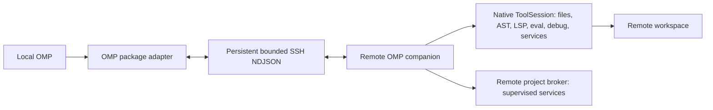

# OMP SSH Remote

[简体中文](README.zh-CN.md) | English

OMP SSH Remote keeps the Oh My Pi control plane local while executing stateful native workspace tools in a persistent companion on a remote Linux host over SSH. This package is OMP-only.

## Runtime Boundary

Local OMP retains the TUI, conversation, model credentials, sessions, Magic Context, `task`, `todo`, browser/computer, peer messaging, and background-job bookkeeping. One remote companion per OMP session owns the remote filesystem, foreground processes, hashline snapshots, AST proposals, LSP clients, eval kernels, debugger sessions, and the project's supervised-process broker.

Remote native tools:

`read`, `write`, `edit`, `bash`, `grep`, `glob`, `lsp`, `ast_grep`, `ast_edit`, constrained `eval`, and `debug`.

Background execution is split by ownership rather than by tool name:

- `bash async:true` creates a job in the local session's OMP job manager; native `wait` and job `proc://` reads/cancellation remain local while the command executes remotely. Independent root sessions do not share a job manager; children use their own session family's manager.
- Named `bash` calls launch remote services. Service `proc://<name>` reads and writes (including `/kill` and `/mode`) execute remotely. Bare `read proc://` combines local and remote listings. Local jobs and agents take precedence over service names; conflicting names are rejected at launch. A local coordination job makes remote service exits visible to native `wait`; transport loss fails that job without moving execution locally.
- On `/remote-exit`, session shutdown, or transport loss the companion stops the supervised processes this session started unless they were launched with `persist` or `detached`; those survive by explicit request, like native OMP.

Ordinary non-isolated subagents inherit connection configuration but receive independent companions. Admission compares the remote execution contract and native tool schemas. `task isolated:true` remains rejected. Native host approval rules are preserved; wrappers are installed at session initialization, before the first model request, not when connecting.

Service coordination reserves a local job before remote startup; a full job manager cannot leave an untracked service running. Completion during startup is retained, and cancellation after successful startup stops the remote service.

OMP 18.11 compatibility: remote async Bash forwards live and terminal card updates while the local job manager still owns logs and `wait`. Named service readiness observes the owning session's steering and peer-message queues; an incoming steer ends only the readiness wait, not the service. Follow-ups and `interruptMode: wait` do not trigger it. This uses public session events rather than the native tool's private steering signal; hidden internal steering without a session queue event is not bridged. Remote `read`/`grep` and hashline `edit` share the native truncated-line protection: reread complete lines with `:raw` before editing them.

Successful explicit service stops also settle their local coordination jobs from the native stop receipt. They are not treated as natural exits: the broker deliberately sends no `daemon-completed` event for an explicit stop. Failed stops leave tracking intact.

OMP 18.12.3 approvals retain native local file/folder grants. Remote targets are hashed, exact-request grants scoped to the current binding, host/user/port/identity, directory, and tool; they never reuse local folder permissions or a different server's permissions. Reconnect or switching bindings invalidates them. A binding change while approval is pending rejects grant recording and execution. Remote folder-wide and cross-session grants are not provided.

Explicit remote async commands use independent per-job native shells. Eligible foreground calls follow the host's automatic-background threshold and steering behavior: promotion keeps the same running request and capture sources, rather than restarting the command. Foreground-backed calls preserve session shell state; immediately backgrounded calls use isolated job shells. A full or unavailable local manager leaves ordinary calls foreground-only. Process listings preserve native renderer metadata, and multi-URI process searches reject mixed local/remote ownership.

Remote jobs supply genuine native capture to local `proc://<local-job-id>/streams[/<n>]` and native progress widgets. Pipeline data is captured before downstream commands such as `tail`; it is not reconstructed from cumulative tool previews. The `out` source is native sanitized text, not arbitrary stdout/stderr bytes. Pipeline sources retain actual bytes. Capture is bounded: native output keeps about 256 Ki UTF-16 units, each pipe keeps 1 MiB, and only the four newest finished pipes remain. Transfer preserves offsets, missing prefixes and stream removals; data the native buffer has already discarded cannot be recovered. Final retained windows are drained before successful/error results settle; cancellation can interrupt a blocked transport write. The per-request remote manager is execution-only: public IDs, cancellation, `wait`, widget model requests and credentials remain local.

Widgets use the host's normal `async.widgets` and `widget` model-role behavior. They need a visible, sufficiently long-running job with enough output; short jobs may show only fallback status. Authoring can make extra local model requests; `async.widgets: false` disables it. No remote model credentials or conversation loop are created.

Remote eval follows native 18.12.3: use `print` or JavaScript `console.log`, not the removed `display`. Larger or multiline plain objects produce JSON views; small objects remain text. Native tables, Markdown and image content are forwarded to the local renderer without requiring a remote UI. Libraries such as pandas must already be installed remotely. JSON values, table cells/headers, Markdown, output anchors and echoed code remain literal application data; artifact publication adapts only owned output metadata and exact native-generated footers. Recovery links distinguish full outputs from capped head/tail samples. URI resolution is limited to read/grep resource operands and the established Bash operand shorthand, not write bodies, eval source or search patterns.

`lsp.requestTimeout` is also forwarded in seconds, preserving per-call timeout overrides.

While connected, direct user shell (`!`/`!!`) and Python shortcuts are explicitly refused rather than silently executed locally. Use remote `bash`/`eval`, or disconnect before using local shortcuts. `find`, `security_scan`, and `ida` are not remote-adapted and remain blocked, including xdev entrypoints. Native `checkpoint` and `rewind` stay local and are allowed: they change conversation history, not remote project files or kernel state. Remote eval supports computation and remote workspace callbacks only: local agent/workpool, judge/completion, archive, browser, and todo helpers are not bridged. The fixed workspace contract explains this distinction; use top-level local orchestration tools instead.

Truncated output is stored remotely under `~/.cache/omp-ssh-remote/artifacts/<namespace>`. Use returned `remote-artifact://<namespace>/<id>` references with `read` selectors or `grep` while connected to that host. The companion deletes its own namespace on normal exit and, at startup, sweeps namespaces older than one hour whose owning worker is gone; artifacts left by a transport loss therefore expire, they are never copied locally. Local `artifact://` references remain local. The `xd://debug` entry executes remotely like direct debug.

A fixed allowlist of execution-domain settings is forwarded to the companion at connection time: `tools.maxTimeout/artifactMaxBytes`, `bash.gitGuard/direnv/direnvLoadTimeoutMs`, `bashInterceptor.enabled/patterns`, `grep.context*`, `read.defaultLimit/renderMarkdown/summarize.*`, `images.autoResize`, `edit.fuzzyMatch/fuzzyThreshold/enforceSeenLines/blockAutoGenerated`, and `lsp.formatOnWrite/diagnostics*`. Values come from the host's effective settings for the local project. `tools.artifactMaxBytes` uses MiB; `0` means unbounded. A configured cap retains a head/tail artifact rather than all emitted bytes. `bash.gitGuard` enforces the native destructive-Git guard remotely. The companion initializes both tool and shell settings in memory without loading the remote project's configuration or copying local credentials. Keys that shape tool schemas (`async.enabled`, `edit.mode`, `eval.*`, `memory.backend`, `skillful`) and approval rules (`bash.patterns`, `bash.allowCompoundCommands`) are never forwarded: schemas are fixed by the compiled companion and approval is evaluated locally. `worktree.clone` is pinned off remotely so `git worktree add` runs as plain git instead of being rewritten into a companion self-invocation. The local active tool set is sent with every call so the bash interceptor can redirect to tools the model actually has.



## Requirements

- local Linux or WSL with OMP `>=18.12.3`, Bun `1.3.14+`, npm, tar, OpenSSH, and SCP;
- remote glibc Linux `x86_64` or `aarch64`;
- public-key SSH that succeeds in batch mode;
- an existing remote project directory;
- the remote host needs project-specific language servers and debug adapters, but does not need Bun or OMP.

Host key verification is strict. Trust a host through normal OpenSSH `known_hosts`; do not disable host checking. Agent forwarding and SSH forwarding are disabled.

## Build and Install

From the repository root:

```bash
bun install --frozen-lockfile
bun run build:omp
bun run build:worker:all
omp plugin link "$PWD/packages/omp"
```

The package must contain:

```text
packages/omp/dist/extension.js
packages/omp/dist/worker-linux-x64
packages/omp/dist/worker-linux-x64.sha256
packages/omp/dist/worker-linux-arm64
packages/omp/dist/worker-linux-arm64.sha256
```

Restart OMP after linking. Updating requires `git pull`, rebuilding the extension and workers, then restarting or reloading the plugin. Reloading while connected closes that session's companion; reconnect afterward.

The companion is built against OMP 18.12.3 (runtime contract 0.11.0). Rebuild both workers when updating runtime dependencies or capture protocol behavior, even if tool schemas have not changed. Native addons are embedded as per-file zstd payloads and extracted on first use; build caches are partitioned by architecture and version. Handshake failures report version and schema drift.

Connection UI reports probe/check/upload/activation stages. The `remote_connect` tool honors cancellation; `/remote-exit` cancels a pending command deployment. Same-host deployments in one extension instance are serialized and recheck the cache, avoiding duplicate uploads. Failed uploads are removed on a best-effort basis if SSH is still reachable. Host schema metadata is cached per loaded extension instance for reconnects and child sessions.

## Connect and Operate

Use a standard `~/.ssh/config` alias or an OMP `/ssh add` entry:

Configured aliases remain the SSH/SCP destination names for `Host` matching; the resolved hostname, user, port and identity still select the actual destination. Alias-only `ProxyCommand`, `ProxyJump` and other OpenSSH settings therefore apply to probes, upload and worker connections without adding duplicate IP-address `Host` entries.

```text
/remote-connect gpu-box /srv/project
/remote-status
/remote-reconnect [--force]
/remote-exit
```

Explicit form:

```text
/remote-connect user@example.com /srv/project --port 22 --identity ~/.ssh/id_ed25519
```

The model can invoke the same lifecycle through `remote_connect`, `remote_workspace_status`, `remote_reconnect`, and `remote_exit`. Status is on-demand and reports in-process state; it is not a per-turn prompt and does not actively ping SSH.

Ordinary filesystem paths route remotely while connected. Internal URI resources remain local. Mixed local-URI and remote-path operations are rejected. A selected connection that becomes unavailable remains fail-closed until `/remote-reconnect` re-establishes the transport or `/remote-exit` explicitly restores local execution. Reconnect reuses the stored connection specification and remote directory, keeps the registered wrappers, drops AST proposals that lived in the dead companion, and is owner-only; `--force` replaces a transport that still looks connected. Non-persistent services stopped by the disconnect are not restarted.

## Deployment and Security

The adapter probes remote platform and home, selects the matching package-owned worker, verifies its local SHA-256 sidecar, uploads to a UUID temporary path with `scp -C` compression, verifies the remote SHA-256, then atomically activates it under:

```text
~/.cache/omp-ssh-remote/omp-1/<sha256>/worker-linux-<arch>
```

Activation prunes older worker directories, keeping the activated build, the most recent previous build, and all live versions. Per-version shared `flock` leases protect worker self-reentry; pruning requires an exclusive lease and checks `/proc` for legacy workers. Protocol frames are limited to 16 MiB; deployment stdout/stderr is limited to 1 MiB. SSH uses batch mode, strict host checking, `ForwardAgent=no`, and `ClearAllForwardings=yes`. Transport loss rejects pending calls and never retries them locally. Foreground child processes receive cancellation; deliberately detached commands such as `nohup` or `setsid` are unmanaged remote processes and can survive disconnect.

## Historical Performance Baseline

October 2026, OMP 18.9.1 on trialsfinder Linux x86_64, cached worker and persistent SSH ControlMaster. Ten interleaved echo/read/bash samples (including first calls):

| Operation | Median |
| --- | --- |
| persistent SSH echo round trip | `8.02 ms` |
| remote read | `24.63 ms` |
| foreground Bash | `17.01 ms` |

Worker initialization was `2439 ms`. A separate initial upload/deployment took `88.36 s`; that run's read/bash medians were roughly `0.8 s`. The later interleaved control returned to the values above. Do not treat these runs as a controlled speedup comparison. Host schema caching avoids repeated metadata-runtime construction but does not reduce each worker's baseline memory; no memory reduction is claimed. ARM64 received build validation, not live performance acceptance.

These measurements predate native capture and widgets; they are not performance claims for the current capture implementation. ARM64 now also has functional capture acceptance, not a performance benchmark.

## Prompt Cache Stability

Connect, disconnect and reconnect change the execution binding, not the tool roster or descriptions. The fixed `remote_workspace_status` description explains routing, remote limitations and when to query status. Native approvals and renderers remain attached; other plugins' tools are not replaced. Tools not bound at startup fail closed remotely rather than being dynamically registered on reconnect.

On a binding change, a short notice is appended to the next provider context without starting another model turn. Unchanged bindings emit no repeated notices. Notice anchors are saved as extension data (not transcript messages) and replayed in their original positions; if compaction removes the anchor, the current state is appended again. Resuming a transcript never restores an SSH connection just because an old notice says it was remote. Calls that overlap a binding change are not retried in the new workspace; stale results and updates are rejected or suppressed.

`scripts/smoke-cache.ts` runs native OMP against a local HTTP endpoint returning synthetic replies. It compares the actual serialized tools, system messages and complete previous request prefix across local/remote/reconnect/local transitions, and executes real workspace commands over SSH. It measures prefix equality, **not provider cache-hit tokens or savings**. Run from the repository root (the bundle is placed beside the workers):

```sh
bun run build
bun scripts/build-smoke.ts cache
REMOTE_CONNECT_ARGS='gpu-box /tmp' bun scripts/run-smoke.ts cache
rm packages/omp/dist/cache-smoke.js
```

`scripts/smoke-lifecycle.ts` additionally checks real file/edit/compute/artifact behavior, async live frames and native `wait`, service steering, explicit-stop tracking, natural exit status, and local restoration. Build it with `bun scripts/build-smoke.ts lifecycle`, then run `REMOTE_CONNECT_ARGS='gpu-box /tmp' bun scripts/run-smoke.ts lifecycle`. Remove the generated bundle afterward.

`scripts/smoke-capture.ts` validates exact pre-`tail` bytes, native widget numbers and rendering, automatic foreground promotion without command replay, persistent versus isolated shells, cancellation, and retained local stream reads after disconnect. Its deterministic author replaces only the model boundary; native spec validation, ingestion and rendering still run. The runner creates a temporary configuration with a short automatic-background threshold and leaves user settings untouched:

```sh
bun scripts/build-smoke.ts capture
REMOTE_CONNECT_ARGS='gpu-box /tmp' bun scripts/run-smoke.ts capture
rm packages/omp/dist/capture-smoke.js
```

`scripts/smoke-rich-output.ts` compares actual native-local and SSH results for JSON, tables, Markdown, valid PNG bytes, literal artifact-like strings, write/read/search/query round trips, and view anchors. Build with `bun scripts/build-smoke.ts rich-output`, then run `REMOTE_CONNECT_ARGS='gpu-box /tmp' bun scripts/run-smoke.ts rich-output`. Neither acceptance script needs a provider request or extra Python packages. Remove its generated bundle afterward. `bun scripts/build-smoke.ts` builds all four acceptance helpers beside the workers.

The runner verifies extension command registration through RPC `get_available_commands` and submits the smoke prompt in the same session only after admission. Missing commands fail before a prompt is sent. The deadline includes the native first-upload budget; cache-hit acceptance avoids deployment timing. Successful temporary sessions are removed; failed sessions are retained for diagnosis.

One plugin upgrade/reload can change the initial prefix. Model/configuration changes, other extensions, compaction and provider cache expiration are outside the connection-switch guarantee. The prefix-stability mechanism itself requires only a local extension rebuild; runtime dependency or protocol changes still require rebuilding and deploying companion binaries.

## Limits

- Linux glibc x86_64 and ARM64 only;
- OMP `>=18.12.3` with matching compiled companion schemas;
- remote `flock` (util-linux) is required: workers hold shared per-version leases so cache pruning cannot delete a live worker's self-reentry executable;
- explicit async Bash and eligible automatic backgrounding are supported; interactive Bash PTY is not bridged;
- no `task isolated:true` remote worktrees;
- no remote-to-local artifact bridge;
- settings outside the forwarded allowlist keep the companion's compiled defaults; there is no arbitrary settings passthrough;
- one companion process per session or subagent; concurrent children each cost an SSH channel and a worker process;
- no output frame above 16 MiB;
- no remote browser, desktop, model credentials, memory, or local session control plane.
