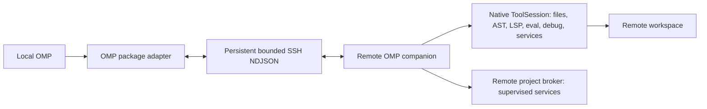

# OMP SSH Remote

[简体中文](README.zh-CN.md) | English

OMP SSH Remote keeps the Oh My Pi control plane local while executing stateful native workspace tools in a persistent companion on a remote Linux host over SSH. This package is OMP-only.

## Runtime Boundary

Local OMP retains the TUI, conversation, model credentials, sessions, Magic Context, `task`, `todo`, browser/computer, peer messaging, and background-job bookkeeping. One remote companion per OMP session owns the remote filesystem, foreground processes, hashline snapshots, AST proposals, LSP clients, eval kernels, debugger sessions, and the project's supervised-process broker.

Remote native tools:

`read`, `write`, `edit`, `bash`, `grep`, `glob`, `lsp`, `ast_grep`, `ast_edit`, constrained `eval`, and `debug`.

Background execution is split by ownership rather than by tool name:

- `bash async:true` creates a job in the local session's OMP job manager; native `wait` and job `proc://` reads/cancellation remain local while the command executes remotely. Independent root sessions do not share a job manager; children use their own session family's manager.
- Named `bash` calls launch remote services. Service `proc://<name>` reads and writes (including `/kill` and `/mode`) execute remotely. Bare `read proc://` combines local and remote listings. Local jobs and agents take precedence over service names; conflicting names are rejected at launch. A local coordination job makes remote service exits visible to native `wait`; transport loss fails that job without moving execution locally.
- On `/remote-exit`, session shutdown, or transport loss the companion stops the supervised processes this session started unless they were launched with `persist` or `detached`; those survive by explicit request, like native OMP.

Ordinary non-isolated subagents inherit connection configuration but receive independent companions. Admission compares the remote execution contract and native tool schemas. `task isolated:true` remains rejected. Native host approval rules are preserved and connection waits for wrapper activation.

Service coordination reserves a local job before remote startup; a full job manager cannot leave an untracked service running. Completion during startup is retained, and cancellation after successful startup stops the remote service.

While connected, direct user shell (`!`/`!!`) and Python shortcuts are explicitly refused rather than silently executed locally. Use remote `bash`/`eval`, or disconnect before using local shortcuts. `find`, `security_scan`, `checkpoint`, `rewind`, and `ida` are not remote-adapted and are blocked (including their xdev entrypoints). Remote eval supports computation and remote workspace callbacks only: local agent/workpool, judge/completion, archive, browser, and todo helpers are not bridged. Its tool description and per-turn notice disclose this boundary; use top-level local orchestration tools instead.

Truncated output is stored remotely under `~/.cache/omp-ssh-remote/artifacts/<namespace>`. Use returned `remote-artifact://<namespace>/<id>` references with `read` selectors or `grep` while connected to that host. The companion deletes its own namespace on normal exit and, at startup, sweeps namespaces older than one hour whose owning worker is gone; artifacts left by a transport loss therefore expire, they are never copied locally. Local `artifact://` references remain local. The `xd://debug` entry executes remotely like direct debug.

A fixed allowlist of execution-domain settings is forwarded to the companion at connection time: `tools.maxTimeout/artifactMaxBytes`, `bash.gitGuard/direnv/direnvLoadTimeoutMs`, `bashInterceptor.enabled/patterns`, `grep.context*`, `read.defaultLimit/renderMarkdown/summarize.*`, `images.autoResize`, `edit.fuzzyMatch/fuzzyThreshold/enforceSeenLines/blockAutoGenerated`, and `lsp.formatOnWrite/diagnostics*`. Values come from the host's effective settings for the local project. `tools.artifactMaxBytes` uses MiB; `0` means unbounded. A configured cap retains a head/tail artifact rather than all emitted bytes. `bash.gitGuard` enforces the native destructive-Git guard remotely. The companion initializes both tool and shell settings in memory without loading the remote project's configuration or copying local credentials. Keys that shape tool schemas (`async.enabled`, `edit.mode`, `eval.*`, `memory.backend`, `skillful`) and approval rules (`bash.patterns`, `bash.allowCompoundCommands`) are never forwarded: schemas are fixed by the compiled companion and approval is evaluated locally. `worktree.clone` is pinned off remotely so `git worktree add` runs as plain git instead of being rewritten into a companion self-invocation. The local active tool set is sent with every call so the bash interceptor can redirect to tools the model actually has.



## Requirements

- local Linux or WSL with OMP `>=18.9.1`, Bun `1.3.14+`, npm, tar, OpenSSH, and SCP;
- remote glibc Linux `x86_64` or `aarch64`;
- public-key SSH that succeeds in batch mode;
- an existing remote project directory;
- the remote host needs project-specific language servers and debug adapters, but does not need Bun or OMP.

Host key verification is strict. Trust a host through normal OpenSSH `known_hosts`; do not disable host checking. Agent forwarding and SSH forwarding are disabled.

## Build and Install

From the repository root:

```bash
bun install --frozen-lockfile
bun run build:omp
bun run build:worker:all
omp plugin link "$PWD/packages/omp"
```

The package must contain:

```text
packages/omp/dist/extension.js
packages/omp/dist/worker-linux-x64
packages/omp/dist/worker-linux-x64.sha256
packages/omp/dist/worker-linux-arm64
packages/omp/dist/worker-linux-arm64.sha256
```

Restart OMP after linking. Updating requires `git pull`, rebuilding the extension and workers, then restarting or reloading the plugin. Reloading while connected closes that session's companion; reconnect afterward.

The companion is built against OMP 18.9.1 (runtime contract 0.8.0). Upgrades that change tool schemas require rebuilding both workers, not just reloading the extension. Native addons are embedded as per-file zstd payloads and extracted on first use; build caches are partitioned by architecture and version. Handshake failures report version and schema drift.

Connection UI reports probe/check/upload/activation stages. The `remote_connect` tool honors cancellation; `/remote-exit` cancels a pending command deployment. Same-host deployments in one extension instance are serialized and recheck the cache, avoiding duplicate uploads. Failed uploads are removed on a best-effort basis if SSH is still reachable. Host schema metadata is cached per loaded extension instance for reconnects and child sessions.

## Connect and Operate

Use a standard `~/.ssh/config` alias or an OMP `/ssh add` entry:

```text
/remote-connect gpu-box /srv/project
/remote-status
/remote-reconnect [--force]
/remote-exit
```

Explicit form:

```text
/remote-connect user@example.com /srv/project --port 22 --identity ~/.ssh/id_ed25519
```

The model can invoke the same lifecycle through `remote_connect`, `remote_workspace_status`, `remote_reconnect`, and `remote_exit`. Status is on-demand and reports in-process state; it is not a per-turn prompt and does not actively ping SSH.

Ordinary filesystem paths route remotely while connected. Internal URI resources remain local. Mixed local-URI and remote-path operations are rejected. A selected connection that becomes unavailable remains fail-closed until `/remote-reconnect` re-establishes the transport or `/remote-exit` explicitly restores local execution. Reconnect reuses the stored connection specification and remote directory, keeps the registered wrappers, drops AST proposals that lived in the dead companion, and is owner-only; `--force` replaces a transport that still looks connected. Non-persistent services stopped by the disconnect are not restarted.

## Deployment and Security

The adapter probes remote platform and home, selects the matching package-owned worker, verifies its local SHA-256 sidecar, uploads to a UUID temporary path with `scp -C` compression, verifies the remote SHA-256, then atomically activates it under:

```text
~/.cache/omp-ssh-remote/omp-1/<sha256>/worker-linux-<arch>
```

Activation prunes older worker directories, keeping the activated build, the most recent previous build, and all live versions. Per-version shared `flock` leases protect worker self-reentry; pruning requires an exclusive lease and checks `/proc` for legacy workers. Protocol frames are limited to 16 MiB; deployment stdout/stderr is limited to 1 MiB. SSH uses batch mode, strict host checking, `ForwardAgent=no`, and `ClearAllForwardings=yes`. Transport loss rejects pending calls and never retries them locally. Foreground child processes receive cancellation; deliberately detached commands such as `nohup` or `setsid` are unmanaged remote processes and can survive disconnect.

## Verified Performance

October 2026, OMP 18.9.1 on trialsfinder Linux x86_64, cached worker and persistent SSH ControlMaster. Ten interleaved echo/read/bash samples (including first calls):

| Operation | Median |
| --- | --- |
| persistent SSH echo round trip | `8.02 ms` |
| remote read | `24.63 ms` |
| foreground Bash | `17.01 ms` |

Worker initialization was `2439 ms`. A separate initial upload/deployment took `88.36 s`; that run's read/bash medians were roughly `0.8 s`. The later interleaved control returned to the values above. Do not treat these runs as a controlled speedup comparison. Host schema caching avoids repeated metadata-runtime construction but does not reduce each worker's baseline memory; no memory reduction is claimed. ARM64 received build validation, not live performance acceptance.

## Limits

- Linux glibc x86_64 and ARM64 only;
- OMP `>=18.9.1` with matching compiled companion schemas;
- remote `flock` (util-linux) is required: workers hold shared per-version leases so cache pruning cannot delete a live worker's self-reentry executable;
- explicit async Bash is supported; automatic backgrounding and interactive Bash PTY are not bridged;
- no `task isolated:true` remote worktrees;
- no remote-to-local artifact bridge;
- settings outside the forwarded allowlist keep the companion's compiled defaults; there is no arbitrary settings passthrough;
- one companion process per session or subagent; concurrent children each cost an SSH channel and a worker process;
- no output frame above 16 MiB;
- no remote browser, desktop, model credentials, memory, or local session control plane.
