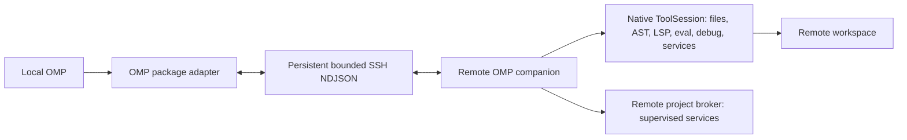

# OMP SSH Remote

[简体中文](README.zh-CN.md) | English

OMP SSH Remote keeps the Oh My Pi control plane local while executing stateful native workspace tools in a persistent companion on a remote Linux host over SSH. This package is OMP-only.

## Runtime Boundary

Local OMP retains the TUI, conversation, model credentials, sessions, Magic Context, `task`, `todo`, browser/computer, peer messaging, and background-job bookkeeping. One remote companion per OMP session owns the remote filesystem, foreground processes, hashline snapshots, AST proposals, LSP clients, eval kernels, debugger sessions, and the project's supervised-process broker.

Remote native tools:

`read`, `write`, `edit`, `bash`, `grep`, `glob`, `lsp`, `ast_grep`, `ast_edit`, constrained `eval`, and `debug`.

Background execution is split by ownership rather than by tool name:

- `bash async:true` creates a job in the local session's OMP job manager; native `wait` and job `proc://` reads/cancellation remain local while the command executes remotely. Independent root sessions do not share a job manager; children use their own session family's manager.
- Named `bash` calls launch remote services. Service `proc://<name>` reads and writes (including `/kill` and `/mode`) execute remotely. Native process-root forms `proc://` and `proc:///` combine local and remote listings. Local jobs and agents take precedence over service names; conflicting names are rejected at launch. A local coordination job makes remote service exits visible to native `wait`; transport loss fails that job without moving execution locally.
- On `/remote-exit`, session shutdown, or transport loss the companion stops the supervised processes this session started unless they were launched with `persist` or `detached`; those survive by explicit request, like native OMP.

Ordinary non-isolated subagents inherit connection configuration but receive independent companions. Admission compares the remote execution contract and native tool schemas. `task isolated:true` remains rejected. Absolute `taskFile` paths are rejected at both top-level and batch entrypoints; use `local://` for host task files, because `task` does not read remote files. Native host approval rules are preserved; wrappers are installed at session initialization, before the first model request, not when connecting.

Eval workspace callbacks use the same host invocation path as top-level tools: the companion requests an invocation, local OMP applies its native approval and tool hooks, and the registered remote wrapper dispatches execution back to the companion. Service startup and explicit stops therefore use the same local coordination jobs from either entrypoint. Each callback belongs to one active Eval request and workspace binding; cancellation or connection replacement invalidates it. Except for the `out://` reply device, nested callbacks cannot select local resources, recursively invoke Eval, or stage AST edits. The companion does not run a second approval engine.

Service coordination reserves a local job before remote startup; a full job manager cannot leave an untracked service running. Completion during startup is retained. Cancellation during readiness or after startup waits for cleanup of the launched instance; an incoming steer only ends the readiness wait and does not stop the service. Worker startup chooses one effective owner for both native execution and shutdown cleanup; an omitted session ID receives a unique worker identity.

OMP 18.11 compatibility: remote async Bash forwards live and terminal card updates while the local job manager still owns logs and `wait`. Named service readiness observes the owning session's steering and peer-message queues; an incoming steer ends only the readiness wait, not the service. Follow-ups and `interruptMode: wait` do not trigger it. This uses public session events rather than the native tool's private steering signal; hidden internal steering without a session queue event is not bridged. Remote `read`/`grep` and hashline `edit` share the native truncated-line protection: reread complete lines with `:raw` before editing them.

Successful explicit service stops also settle their local coordination jobs from the native stop receipt. They are not treated as natural exits: the broker deliberately sends no `daemon-completed` event for an explicit stop. Failed stops leave tracking intact.

OMP 18.12.3 approvals retain native local file/folder grants. Remote targets are hashed, exact-request grants scoped to the current binding, host/user/port/identity, directory, and tool; they never reuse local folder permissions or a different server's permissions. Reconnect or switching bindings invalidates them. A binding change while approval is pending rejects grant recording and execution. Remote folder-wide and cross-session grants are not provided. Approval prompts keep the native tool's details (command, path, content) and, for a remotely routed call, add the `Remote: <target>:<cwd>` it will run in.

Explicit remote async commands use independent per-job native shells. Eligible foreground calls follow the host's automatic-background threshold and steering behavior: promotion keeps the same running request and capture sources, rather than restarting the command. Foreground-backed calls preserve session shell state; immediately backgrounded calls use isolated job shells. A full or unavailable local manager leaves ordinary calls foreground-only. Process listings preserve native renderer metadata, and multi-URI process searches reject mixed local/remote ownership.

Remote Bash exports the owning session's `PI_SESSION_ID`, including in isolated background jobs. `PI_SESSION_FILE` is empty because the companion does not own a local transcript; local session paths are not forwarded.

Remote jobs supply genuine native capture to local `proc://<local-job-id>/streams[/<n>]` and native progress widgets. Pipeline data is captured before downstream commands such as `tail`; it is not reconstructed from cumulative tool previews. The `out` source is native sanitized text, not arbitrary stdout/stderr bytes. Pipeline sources retain actual bytes. Capture is bounded: native output keeps about 256 Ki UTF-16 units, each pipe keeps 1 MiB, and only the four newest finished pipes remain. Transfer preserves offsets, missing prefixes and stream removals; data the native buffer has already discarded cannot be recovered. Final retained windows are drained before successful/error results settle; cancellation can interrupt a blocked transport write. The per-request remote manager is execution-only: public IDs, cancellation, `wait`, widget model requests and credentials remain local.

Widgets use the host's normal `async.widgets` and `widget` model-role behavior. They need a visible, sufficiently long-running job with enough output; short jobs may show only fallback status. Authoring can make extra local model requests; `async.widgets: false` disables it. No remote model credentials or conversation loop are created.

Remote eval follows native 18.12.3: use `print` or JavaScript `console.log`, not the removed `display`. Larger or multiline plain objects produce JSON views; small objects remain text. Native tables, Markdown and image content are forwarded to the local renderer without requiring a remote UI. Libraries such as pandas must already be installed remotely. JSON values, table cells/headers, Markdown, output anchors and echoed code remain literal application data; artifact publication adapts only owned output metadata and exact native-generated footers. Recovery links distinguish full outputs from capped head/tail samples. URI resolution is limited to read/grep resource operands and the established Bash operand shorthand, not write bodies, eval source or search patterns.

`lsp.requestTimeout` is also forwarded in seconds, preserving per-call timeout overrides.

Remote Bash `> out://` and foreground Eval's `tool.write({path:"out://", ...})` / `tool.bash` replies use the native transcript reply channel. Connection setup captures the host's effective reply gate, including explicit `out.enabled` and the actual native session's TUI capability; subagents remain refused. Reply text is carried in native `details.replies`, never written to the remote filesystem. Other host resources such as `local://` and `skill://` are not bridged into remote execution. Extension/MCP tools not supplied by the remote runtime continue to execute on the local host; they are not blanket-blocked.

While connected, direct user shell (`!`/`!!`) and Python shortcuts are explicitly refused rather than silently executed locally. Use remote `bash`/`eval`, or disconnect before using local shortcuts. `find`, `security_scan`, and `ida` are not remote-adapted and remain blocked, including xdev entrypoints. Native `checkpoint` and `rewind` stay local and are allowed: they change conversation history, not remote project files or kernel state. Remote eval supports computation and remote workspace callbacks only: local agent/workpool, judge/completion, archive, browser, and todo helpers are not bridged. The fixed workspace contract explains this distinction; use top-level local orchestration tools instead.

While a remote runtime is selected, native input hooks reject `/git`, `/security`, `/wt` (including `/worktree`), `/move`, `/add-dir`, `/remove-dir`, `/review`, `/annotate`, `/loop` with a native `--until` or `--while` shell condition (including `=` forms), and native `@path` file mentions: these would use the local workspace or shell. Builtin colon syntax and bare command words enabled by `input.bareSlashCommands` are covered too. Use remote `bash`/`read` instead; drop `@` from file paths. Plain `/loop` remains available. This guard covers TUI and RPC submissions that emit the native input event, not startup, print-mode, or subagent prompts; it is not a complete host-execution boundary.

GitHub operations are limited to explicit API reads. Non-search reads require an explicit `repo` rather than inferring a repository from the local directory. Remote mode rejects `pr_create`, `pr_checkout`, `pr_push`, and unknown operations.

Truncated output is stored remotely under `~/.cache/omp-ssh-remote/artifacts/<namespace>`. Use returned `remote-artifact://<namespace>/<id>` references with `read` selectors or `grep` while connected to that host. Remote `bash` resolves them through the embedded shell's read-only URL filesystem, exactly like native `artifact://`: the approved command text is never rewritten, external programs receive the real path, and writes are refused. Only the worker mounts the scheme; the host never resolves it. The companion deletes its own namespace on normal exit and, at startup, sweeps namespaces older than one hour whose owning worker is gone; artifacts left by a transport loss therefore expire, they are never copied locally. Local `artifact://` references remain local. The `xd://debug` entry executes remotely like direct debug.

Remote conflict registrations return `remote-conflict://<binding>/<id>` references. Read `/ours`, `/theirs`, or `/base`, or write the bound reference to resolve the remote block; bulk writes use `*` under the same binding. Bare `conflict://` remains local. Reconnect or exit invalidates old remote references: reread the file. Edit routing inspects move destinations as well as source paths and rejects cross-domain `MV`.

A fixed allowlist of execution-domain settings is forwarded at connection time: `tools.maxTimeout/artifactMaxBytes`, `bash.gitGuard/direnv/direnvLoadTimeoutMs`, `bashInterceptor.enabled/patterns`, `grep.context*`, `read.defaultLimit/renderMarkdown/summarize.*`, `images.autoResize`, `edit.fuzzyMatch/fuzzyThreshold/enforceSeenLines/blockAutoGenerated`, and `lsp.formatOnWrite/diagnostics*`. Values come from the host's effective project settings. `tools.artifactMaxBytes` uses MiB; `0` means unbounded, while a configured cap retains a head/tail artifact. `bash.gitGuard` enforces native destructive-Git protection remotely. Tool and shell settings initialize in memory without loading remote project configuration or copying credentials. Effective `edit.mode` is negotiated separately, including host model and environment overrides; remote read and edit use the same language, checked against the actual host schema and grammar. A host edit-mode change requires reconnecting before further remote reads or edits. Other structural keys (`async.enabled`, `eval.*`, `memory.backend`, `skillful`) remain companion-owned; approval rules (`bash.patterns`, `bash.allowCompoundCommands`) remain local. `worktree.clone` is pinned off so ordinary `git worktree add` is not rewritten into a companion self-invocation. Every call includes the current local active tool set for the bash interceptor.



## Requirements

- local Linux or WSL with OMP `>=18.16.0`, Bun `1.4.4+`, npm, tar, OpenSSH, and SCP;
- remote glibc Linux `x86_64` or `aarch64`;
- public-key SSH that succeeds in batch mode;
- an existing remote project directory;
- the remote host needs project-specific language servers and debug adapters, unless using an opt-in private Python or TypeScript LSP pack below; it does not need Bun or OMP.

Host key verification is strict. Trust a host through normal OpenSSH `known_hosts`; do not disable host checking. Agent forwarding and SSH forwarding are disabled.

## Build and Install

From the repository root:

```bash
bun install --frozen-lockfile
bun run build:omp
bun run build:worker:all
omp plugin link "$PWD/packages/omp"
```

The package must contain:

```text
packages/omp/dist/extension.js
packages/omp/dist/worker-linux-x64
packages/omp/dist/worker-linux-x64.sha256
packages/omp/dist/worker-linux-arm64
packages/omp/dist/worker-linux-arm64.sha256
```

Restart OMP after linking. Rebuild the extension and both workers when updating. Run `/remote-exit` before disabling, suspending, or reloading the extension. OMP 18.12.6 dynamic suspension neither sends shutdown nor offers a before-suspend hook: suspending a connected extension restores native local tools but may retain its old worker. A plugin cannot guarantee interception or cleanup after its own hooks have been suspended.

The companion is built against OMP 18.16.0 (runtime contract 0.15.0). Build identity comes from the installed source and native dependencies, never an OMP executable on PATH. Rebuild both workers when updating runtime dependencies or capture behavior, even if schemas are unchanged. Native addons are embedded as per-file zstd payloads and extracted on first use; build caches are partitioned by architecture and version. Admission reports version, edit-language, and schema drift.

Uploads explicitly use `scp -O` (the SCP protocol), because remote destination paths are shell-quoted; the SFTP default in OpenSSH 9+ would treat those quotes as literal filename characters. The local SCP client must support `-O`.

Connection UI reports probe/check/upload/activation stages. Both `remote_connect` and `remote_reconnect` honor call cancellation; `/remote-exit` cancels pending command deployment. Same-host deployments in one instance serialize and recheck the cache. Failed uploads are removed best-effort when SSH is reachable. Each connection snapshots the current host tool contract rather than reusing another session or model's handshake.

## Connect and Operate

Use a standard `~/.ssh/config` alias or an OMP `/ssh add` entry:

For `~/.ssh/config`, the plugin discovers concrete names from `Host` lines only, including multiple names per line; wildcard and negated patterns are not listed. It passes the alias directly to OpenSSH without copying `HostName`, `User`, `Port`, or `IdentityFile` into command-line overrides. OpenSSH resolves `Include`, `Match`, `ProxyCommand`, `ProxyJump`, and all other connection settings. Aliases declared only in included files can also be entered directly.

OMP `ssh.json` entries are explicit plugin overrides: their hostname, user, port, and identity take precedence while the original alias remains the destination for native `Host` matching. Explicit `--port` and `--identity` flags override saved values.

```text
/remote-connect gpu-box /srv/project
/remote-status
/remote-reconnect [--force]
/remote-exit
```

Explicit form:

```text
/remote-connect user@example.com /srv/project --port 22 --identity ~/.ssh/id_ed25519
```

Targets also accept IPv4, bare or bracketed IPv6, and usernames containing `+`, for example `developer+ci@[2001:db8::1]`. Omit the directory to use the remote home. The worker is selected and deployed automatically; `--worker` is not supported.

The model can invoke the same lifecycle through `remote_connect`, `remote_workspace_status`, `remote_reconnect`, and `remote_exit`. Status is on-demand and reports in-process state; it is not a per-turn prompt and does not actively ping SSH.

Ordinary paths route remotely; local internal resources stay local and explicit remote references route by binding. Mixed-domain operations are rejected. An unavailable selected connection remains fail-closed. Each session may reconnect its own independent transport; only the owner can exit and close the family. Reconnect uses the original canonical directory, drops that companion's AST proposals, and accepts `--force` to replace a live transport. Stopped non-persistent services are not restarted. Owner reconnect does not restart child kernels; children can reconnect independently. Forced family closure leaves active descendants unavailable rather than allowing new tasks to fall back locally.

## Optional Private Python LSP Pack (Prototype)

This opt-in ships **Node 22.22.0 + Pyright 1.1.407** privately; it does not install npm, Node, Python packages, or project dependencies remotely. Python analysis still uses the project's own interpreter/configuration. Both preparation and opt-in deployment require existing `python3` (stdlib only); launching the server uses pack-owned Node. Linux glibc ARM64 and x64 are supported build targets; real-host acceptance is separate from building the artifacts.

Prepare only the architecture you intend to deploy, from the repository root:

```sh
bun scripts/prepare-python-lsp.ts arm64  # or x64
bun run build:omp
bun run build:worker:all
```

Preparation downloads exact upstream archives into the ignored local `.cache/`, checks official [Node SHA-256 pins](https://nodejs.org/dist/v22.22.0/SHASUMS256.txt) and [Pyright npm SRI](https://registry.npmjs.org/pyright/1.1.407), and produces `packages/omp/dist/python-lsp-linux-<arch>.tar.gz` plus `.json`. No package-manager install scripts run. The pack contains `manifest.json`, `bin/node`, a physical-path `bin/pyright-langserver` launcher, the complete published `pyright/` runtime/resources/license tree, and `licenses/node-LICENSE` including Node's bundled notices. The manifest records provenance and every file's SHA-256/mode; its exact bytes define an independent pack ID. The descriptor separately pins the archive SHA-256. Keep both optional artifacts beside `extension.js` when distributing an enabled pack.

Enable only the selected alias in local project `.omp/ssh.json` or user `~/.omp/agent/ssh.json` (retain your existing SSH fields):

```json
{"hosts":{"python-box":{"host":"example.com","lsp":{"python":true}}}}
```

Connect using that alias. Plain SSH aliases/direct `user@host` connections remain unchanged unless a matching OMP alias explicitly enables the pack. A missing local pack, missing remote Python, or partial/corrupt remote cache fails preparation with an error rather than silently claiming the fallback is enabled. Reconnects and child workers preserve opt-in and receive the immutable path through their own launch environment, not global `PATH`; tool schemas/RPC are unchanged.

The first connection transfers the compressed archive over the existing strict SSH/SCP path. Remote stdlib code checks the archive checksum, rejects traversal, absolute paths, links and special members before extraction, verifies manifest contents/modes, and publishes under a per-content lock with atomic staging rename:

```text
~/.cache/omp-ssh-remote/language-packs/python/linux-<arch>/<pack-id>/
```

Later connections verify and reuse the complete cache without upload. Full file hashing on reuse is intentional in this prototype and adds local/remote I/O; it is not a sidecar-only fast path. Packs have **no automatic GC** and are independent of the two-worker retention window. Invalid existing final directories are refused, not overwritten or recursively removed; remove only the specifically diagnosed pack directory yourself after stopping its users if repair is needed.

Native LSP discovery, root markers, lazy startup, diagnostics-on-edit and reload remain native. Project-local/PATH servers win; the private launcher is used only for missing default Pyright. Explicit Pyright `command`, `disabled`, file-type or root-marker configuration is not replaced. A configured semantic alternative (even missing) or an installed basedpyright/pylsp/other Python semantic server suppresses the extra Pyright; Ruff alone does not. Settings-only Pyright configuration can use the fallback. The worker build narrowly adapts SDK **18.16.0** configuration loading after native resolution; mismatched version/source anchors fail the build. Installed OMP source is never edited and native runtime exports are not monkeypatched.

Use existing remote `pyrightconfig.json` / `pyproject.toml` for analysis paths and environments. If an explicit remote interpreter is needed, use native project `lsp.json` settings without a `command` override:

```json
{"servers":{"pyright":{"settings":{"python":{"pythonPath":"/srv/project/.venv/bin/python"}}}}}
```

That path is remote, project-owned and must already exist. The extension neither guesses arbitrary venvs nor writes this configuration. Inspect native `lsp` status/reload and exercise definition/references/diagnostics for the actual project; a running server is not proof of correct environment resolution.

## Optional Private TypeScript LSP Pack

The second pack uses the same bounded archive validation, per-manifest lock, atomic extraction and full cache verification as Python, with a separate TypeScript required-file profile. Python's format-1 manifest, artifact names and content-addressed cache layout remain compatible; no old cache is deleted or migrated.

It pins **Node 22.22.0 + typescript-language-server 4.3.4 + TypeScript 5.8.3**. The published language server bundles its runtime dependencies, and TypeScript has no runtime npm dependency edges; preparation rejects unexpected dependency edges rather than resolving a floating tree. Both official npm archives are SRI-pinned ([server metadata](https://registry.npmjs.org/typescript-language-server/4.3.4), [TypeScript metadata](https://registry.npmjs.org/typescript/5.8.3)). Complete published package trees retain upstream licenses/notices, including the server's Apache/MIT notices, TypeScript's Apache license/third-party notices, and Node's license aggregation. No npm install or lifecycle script runs locally or remotely.

```sh
bun scripts/prepare-typescript-lsp.ts arm64  # or x64
```

Keep `packages/omp/dist/typescript-lsp-linux-<arch>.tar.gz` and `.json` beside the extension. Enable only an OMP SSH alias:

```json
{"hosts":{"code-box":{"host":"example.com","lsp":{"typescript":true,"python":false}}}}
```

Either boolean can be omitted; unknown keys and non-boolean values are rejected. This is local host configuration, not a model-facing `remote_connect` parameter. Preparation/deployment requires existing stdlib `python3`; the physical launcher uses absolute pack-owned Node without changing `PATH`. The worker receives only its selected `OMP_REMOTE_TYPESCRIPT_LSP_PACK`. First deployment publishes to `~/.cache/omp-ssh-remote/language-packs/typescript/linux-<arch>/<pack-id>/`; reconnect verifies and reuses it. Packs remain outside worker GC.

Only an unresolved native default `typescript-language-server` gets the private launcher. Explicit command/disable/file-type/root-marker intent and custom semantic servers take precedence; linters do not suppress semantic fallback. Native TypeScript selection still probes project/PATH `tsc`: usable native TS7 wins, while TS5 `tsc` alone is not an LSP server. Within TLS, explicit initialization `tsserver.path` wins, then project TypeScript (including supported PnP SDK paths), and finally the bundled TypeScript. The pack does not force its older TypeScript over the project's version. Native `lsp` actions, edit diagnostics and reload use the same native clients; this is not a parallel LSP implementation. Other languages require their own opt-in packs.

The private TLS fallback defaults `initOptions.disableAutomaticTypingAcquisition` to `true`, preventing unsolicited npm-based acquisition. Existing project initialization options are preserved: an explicit `false` opts back into upstream behavior and requires project-owned remote npm/network access. Known supplemental servers such as Tailwind, HTML/CSS helpers and linters coexist with the semantic TypeScript fallback.

Late write/edit diagnostics return to the owning host session's native yield queue, scoped to the exact session and connection binding. Native deduplication is retained; consumption-time version checks reject obsolete results. Mutating tool requests serialize until actual operation settlement, with per-file content revisions covering LSP/AST changes that omit native mutation counters. Cancellation remains cooperative but waits for an in-flight native mutation to settle before releasing that delivery barrier.

Worker builds apply narrowly guarded SDK 18.16.0 adaptations for configuration fallback and mutation settlement. They also correct native single/batch writethrough finalization: a formatter-only, unverified diagnostic placeholder must not cancel a pending late diagnostic fetch. Verified inline clean/error results retain native finalization. Source drift fails the build; the installed host SDK is not modified.

## Optional Private C/C++ LSP Pack

Enable `"lsp":{"cpp":true}` on a local SSH alias independently of Python/TypeScript. Prepare either architecture with `bun scripts/prepare-cpp-lsp.ts arm64` (or `x64`) and retain `packages/omp/dist/cpp-lsp-linux-<arch>.{tar.gz,json}` beside the extension. Preparation requires existing `python3` and `readelf`; deployment requires stdlib `python3`, not apt, pip, npm or a compiler installation.

Both architectures pin the same **clangd 23.1.5** LLVM Focal package build (`a738f2737189`, dated 2026-10-28). This is an official [apt.llvm.org](https://apt.llvm.org/) packaged branch build, not the standalone 23.1.0 release and not a third-party PyPI binary. Exact package versions, URLs, SHA-256 values, signed metadata hashes and signing fingerprints are recorded in `src/cpp-lsp-pack.ts`. LLVM Release signatures and Ubuntu InRelease signatures were verified when these pins were audited; preparation verifies immutable package hashes rather than trusting a changing repository index. Focal's 22 branch no longer supplied the needed ARM64 binaries at pinning time.

The pack contains clangd, Clang resource headers, libclang-cpp, libLLVM and its audited private shared-library closure. ARM64 needs only private GCC C++/unwind runtime libraries; x64 additionally includes libffi, libedit, libxml2, zlib, zstd, BSD/tinfo, ICU and lzma libraries. Every shipped ELF is architecture-checked and requires at most **glibc 2.29**; glibc and its system ELF loader are not bundled. Each package's copyright notices, GCC runtime exception and full referenced common license texts are retained. LLVM uses Apache-2.0 with LLVM exceptions; dependency licenses remain their own, including GCC's runtime exception and LGPL components. No package is installed into the remote OS or project.

The runtime pins use public Focal repositories, not Ubuntu Pro/ESM. [Focal's standard security maintenance ended in May 2025](https://ubuntu.com/about/release-cycle); authenticated provenance and ABI compatibility do not guarantee current security fixes. These private libraries need separate security review and pin updates, especially before parsing untrusted projects.

Deployment reuses the common format-1 manifest, bounded regular-file-only archive, content-addressed cache verification and atomic publication under `~/.cache/omp-ssh-remote/language-packs/cpp/linux-<arch>/<pack-id>/`. Only the selected worker receives `OMP_REMOTE_CPP_LSP_PACK`. Its `bin/clangd` launcher invokes the architecture's system loader with a private library search path and explicit private resource directory; it changes neither `PATH` nor `LD_LIBRARY_PATH`. Python/TypeScript manifest identities and caches remain unchanged.

Only a missing native default clangd executable receives this fallback. Project/PATH clangd, explicit command/disable/file types/root markers and configured semantic alternatives such as ccls win, even if an explicitly selected alternative is unavailable. Native arguments (`--background-index`, `--clang-tidy`, `--header-insertion=iwyu`) and native file types remain unchanged. Background indexing may create clangd's ordinary project cache. No wildcard `--query-driver` is enabled: executing a project compiler for include discovery requires explicit project authorization/configuration.

The pack does not supply a C/C++ standard library SDK, compiler, vendor SDK or project compile database. Those remain project-owned. clangd uses existing `compile_commands.json` and `.clangd`; use native `lsp.json` arguments for an explicit `--compile-commands-dir=...` when needed. Verify actual standard headers and vendor APIs on the target project, not just server startup. CUDA/Objective-C file types are inherited native selection, not a claim that their SDKs are bundled.

The `cpp-lsp` smoke suite always runs its scratch C++ checks. To add read-only acceptance on an existing project, set `REMOTE_CPP_PROJECT_ROOT` (absolute), `REMOTE_CPP_PROJECT_DATABASE`, `REMOTE_CPP_PROJECT_FILE`, `REMOTE_CPP_PROJECT_SYMBOL`, `REMOTE_CPP_PROJECT_LINE`, `REMOTE_CPP_PROJECT_DEFINITION_FILE`, `REMOTE_CPP_PROJECT_DEFINITION_LINE`, and `REMOTE_CPP_PROJECT_REFERENCE_COUNT`. File/database paths may be absolute or relative to the project root; line numbers are one-based and the reference count is exact. The selected file must have exactly one compile command. Diagnostics must be clean unless every message matches an explicitly supplied JavaScript regexp in `REMOTE_CPP_PROJECT_DIAGNOSTIC_PATTERN`; missing headers always fail. The suite uses the packaged clangd with background indexing disabled, puts its configuration in scratch, and verifies unchanged source, definition and database hashes.

## Deployment and Security

The adapter probes remote platform and home, selects the matching package-owned worker, verifies its local SHA-256 sidecar, uploads to a UUID temporary path with `scp -C` compression, verifies the remote SHA-256, then atomically activates it under:

```text
~/.cache/omp-ssh-remote/omp-1/<sha256>/worker-linux-<arch>
```

After native admission succeeds, connect/reconnect records a monotonic last-used sequence and collects managed worker caches across namespaces. The default window is **two distinct worker hashes**: the just-used build and the most recently used other build. Repeated use does not create another generation; rollback updates use order. Duplicate namespace copies count as replicas, not distinct builds. Busy builds and replicas are exempt, so long-lived workers can temporarily exceed the window; the next successful connection retries cleanup.

Deployment holds a shared build lease through upload and admission, then hands off to the worker's lifetime lease. A single root `flock` serializes metadata commits, activation and collection; deletion requires a nonblocking exclusive build lease and a legacy `/proc` check. Only strict native ownership manifests and known direct-child contents permit deletion. Shared companion targets are never deleted. A one-time bootstrap adopts the established `omp-1` no-companion layout only with matching checksum sidecars; its initial ordering is explicitly directory-mtime-derived, not recovered usage history. Unregistered failed installs, unknown namespaces (including numeric names), malformed metadata and unfamiliar files remain untouched. No old executable is run and no fleet-wide binary rehash is needed.

Each successful connection reports retained distinct builds/replicas, deleted replicas and fully removed build hashes, busy exemptions, and unclassified hash-directory candidates. Sizes sum **allocated disk bytes of regular, non-symlink worker binaries**, not logical sizes or total cache usage; shared assets are excluded. Commit/collection has a 10-second budget and failure reports unavailable rather than zero usage. Failed upload or native admission does not advance usage. Status exposes this timestamped snapshot without SSH. Protocol frames are limited to 16 MiB; deployment output to 1 MiB. SSH remains batch mode with strict host checking, `ForwardAgent=no`, and `ClearAllForwardings=yes`; transport loss never retries tools locally. Deliberately detached processes such as `nohup` or `setsid` remain unmanaged.

## Historical Performance Baseline

October 2026, OMP 18.9.1 on a Linux x86_64 acceptance host, cached worker and persistent SSH ControlMaster. Ten interleaved echo/read/bash samples (including first calls):

| Operation | Median |
| --- | --- |
| persistent SSH echo round trip | `8.02 ms` |
| remote read | `24.63 ms` |
| foreground Bash | `17.01 ms` |

Worker initialization was `2439 ms`. A separate initial upload took `88.36 s`, with read/bash medians around `0.8 s`; the later interleaved control returned to the table above. These are historical measurements, not a controlled speedup comparison or current-version memory/performance claims. ARM64 has build validation, not live performance acceptance.

### 0.13.1 controlled local comparison

On Linux x86_64 with Bun 1.4.4 and OMP 18.15.0, three alternating baseline/candidate pairs used fresh processes and warm filesystem caches. Language-pack verification still checks every manifest-listed file, mode and checksum; only hashing changes to bounded streaming reads. For the same C++ pack (345 files, 287,392,119 bytes), complete Python cache verification median peak RSS fell from **166.13 to 22.04 MiB**; elapsed time was **271.79 to 202.46 ms**. Local archive hashing (87,563,069 bytes) fell from **115.71 to 69.21 MiB** peak RSS, **76.49 to 64.15 ms**. These are transient verification costs, not resident worker memory or SSH latency.

A separate compiled lifecycle comparison staged both binaries onto the same path, initialized a companion, reused a real JS kernel, and started an owned ready service. Six simultaneous memory samples per run, then three paired-run medians, gave combined companion/JS/broker PSS **488.77 → 417.54 MiB**. Initialized JS PSS was **145.50 → 102.89 MiB** and serving broker **148.05 → 112.90 MiB**. Companion RSS was essentially unchanged (**246.19 → 246.45 MiB**); its PSS increased **195.20 → 201.34 MiB**, partly reflecting shared-page attribution. Do not claim main-worker savings. Cold JS/service request medians were **705.43 → 550.72 ms / 781.67 → 626.27 ms**; warm requests showed no demonstrated improvement. Subprocess state and cleanup semantics are unchanged; this does not measure large-project LSP memory or remote network performance.


## Prompt Cache Stability

Connect, disconnect and reconnect change the execution binding, not the tool roster or descriptions. The fixed `remote_workspace_status` description explains routing, remote limitations and when to query status. Native approvals and renderers remain attached; other plugins' tools are not replaced. Tools not bound at startup fail closed remotely rather than being dynamically registered on reconnect.

Binding changes enter native message history through the next `before_agent_start`, before MC or other context transforms. They do not start an extra model turn, append after `context`, or replay private message anchors. The current native branch, including persisted `custom_message` entries, determines which binding has actually been announced; returning a hook result does not consume an announcement. Fresh local sessions add no environment message, unchanged accepted state is not repeated, and cancelled preparation can retry its announcement. Cold restore, resume and branch navigation correct remote history to the current local environment without automatically connecting SSH. After compaction the next user turn may reannounce the selected remote binding. Calls overlapping a binding change are not retried in the new workspace; stale results and updates are rejected or suppressed.

`scripts/smoke-cache.ts` runs native OMP against a local HTTP endpoint returning synthetic replies. It compares the actual serialized tools, system messages and complete previous request prefix across local/remote/reconnect/local transitions, and executes real workspace commands over SSH. It measures prefix equality, **not provider cache-hit tokens or savings**. Run from the repository root. Smoke bundles live in gitignored `.cache/smoke/`, outside the shipped package; they load the release extension from `packages/omp/dist/` so worker resolution stays unchanged:

```sh
bun run build
bun scripts/build-smoke.ts cache
REMOTE_CONNECT_ARGS='gpu-box /tmp' bun scripts/run-smoke.ts cache
rm .cache/smoke/cache-smoke.js
```

For the installed MC compatibility extension, use the separate combined mode. It keeps MC's context transform and dispatch fence enabled, loads MC before remote, and requires exactly one HTTP request for each of the seven state transitions. MC retagging is not treated as a remote prefix-equality failure. Auxiliary MC model consumers are disabled, and configuration, session, database and logs are isolated in a temporary directory:

```sh
bun scripts/build-smoke.ts cache-mc
CACHE_SMOKE_MC_COMPAT=/path/to/omp-mc-compat/index.js \
  REMOTE_CONNECT_ARGS='gpu-box /tmp' bun scripts/run-smoke.ts cache-mc
rm .cache/smoke/cache-smoke.js
```

The default mock uses native Chat Completions. Set `CACHE_SMOKE_API=openai-responses` for the native Responses endpoint and parser; this mode emits numbered assistant messages with opaque reasoning, then verifies replay order, phase, encrypted payload and removal of old numbers. Output IDs remain in persisted native history but may be removed from HTTP input by OMP's native replay sanitization.

Set `SMOKE_KEEP_ARTIFACTS=1` to retain `mc.log`, `wire-requests.json` and the isolated session/database for inspection. Dynamic extension suspension while connected is unsupported; disconnect remote before disabling or reloading the extension.


`scripts/smoke-lifecycle.ts` additionally checks real file/edit/compute/artifact behavior, direct and nested native approval, nested service startup/stop coordination, async live frames and native `wait`, service steering, natural exit status, and local restoration. Build it with `bun scripts/build-smoke.ts lifecycle`, then run `REMOTE_CONNECT_ARGS='gpu-box /tmp' bun scripts/run-smoke.ts lifecycle`. Remove the generated bundle afterward.

`scripts/smoke-capture.ts` validates exact pre-`tail` bytes, native widget numbers and rendering, automatic foreground promotion without command replay, persistent versus isolated shells, cancellation, and retained local stream reads after disconnect. Its deterministic author replaces only the model boundary; native spec validation, ingestion and rendering still run. The runner creates a temporary configuration with a short automatic-background threshold and leaves user settings untouched:

```sh
bun scripts/build-smoke.ts capture
REMOTE_CONNECT_ARGS='gpu-box /tmp' bun scripts/run-smoke.ts capture
rm .cache/smoke/capture-smoke.js
```

`scripts/smoke-rich-output.ts` compares actual native-local and SSH results for JSON, tables, Markdown, valid PNG bytes, literal artifact-like strings, write/read/search/query round trips, and view anchors. Build with `bun scripts/build-smoke.ts rich-output`, then run `REMOTE_CONNECT_ARGS='gpu-box /tmp' bun scripts/run-smoke.ts rich-output`. Neither acceptance script needs a provider request or extra Python packages. Remove its generated bundle afterward. `bun scripts/build-smoke.ts` builds all six acceptance helpers in `.cache/smoke/`.

The runner verifies extension command registration through RPC `get_available_commands` and submits the smoke prompt in the same session only after admission. Missing commands fail before a prompt is sent. The deadline includes the native first-upload budget; cache-hit acceptance avoids deployment timing. Successful temporary sessions are removed; failed sessions are retained for diagnosis.

Set `SMOKE_ADMISSION_ONLY=1` when running a built smoke helper to check extension admission in the actual compiled OMP host without submitting a prompt, calling a provider, or connecting SSH. This checks the host's exposed module boundary; source-level imports and a successful bundle alone do not establish compiled-host compatibility.

One plugin upgrade/reload can change the initial prefix. Model/configuration changes, other extensions, compaction and provider cache expiration are outside the connection-switch guarantee. The prefix-stability mechanism itself requires only a local extension rebuild; runtime dependency or protocol changes still require rebuilding and deploying companion binaries.

## Limits

- Linux glibc x86_64 and ARM64 only;
- OMP `>=18.16.0` with matching compiled companion schemas;
- remote `flock` (util-linux) is required: workers hold shared per-version leases so cache pruning cannot delete a live worker's self-reentry executable;
- explicit async Bash and eligible automatic backgrounding are supported; interactive Bash PTY is not bridged;
- remote image questions (`?q=`) are not supported; read the image directly to give the model its pixels;
- no `task isolated:true` remote worktrees;
- no remote-to-local artifact bridge;
- settings outside the forwarded allowlist keep the companion's compiled defaults; there is no arbitrary settings passthrough;
- `tools.restrictedFolders` applies to native local resources; remote filesystem restriction prompts are not implemented;
- Native host approval and enabled-tool gating are retained, but SDK 18.16.0 has no public AgentSession API for effective `ToolSession.lspReadOnly` / `deviceOnlyWrite` policy. Remote execution cannot mirror explicit per-session overrides of those fields; do not use this release as a read-only sandbox. AgentRef read-only history metadata is not the execution policy.
- one companion process per session or subagent; concurrent children each cost an SSH channel and a worker process;
- Connect parks this session's idle subagents; messaging them revives their sessions with remote workspace tools. Connect uses the same native check-and-park sequence as the idle TTL (`ircWakesPending`, then `AgentLifecycleManager.park`), so a message whose delivery has already passed native liveness admission at connect can be lost in the same window as native TTL parking. Live agents left from a previous session in the same process can still be woken by explicit agent messaging and then run locally. Children without a transcript are conservatively treated as running when their parent chain reaches this session or its owner id, since the shared Main id cannot distinguish roots during initialization.
- no output frame above 16 MiB;
- host Git status/overlay and status-line Git information describe the local repository, not the bound remote workspace;
- plan autosave (`plan.autosave`) writes to local `.omp/plans/`;
- `/clear` and prompt refresh re-read local project context files;
- native hooks and `pi.exec` execute locally;
- remote Bash may still accept `out://` after automatic background promotion, unlike native background execution;
- remote AST previews do not enforce native pending-preview reminders or escalation;
- Cursor models and effective Cursor advisors are refused at connect and before each turn. Advisor workspace calls through `tool_call` are blocked, but Cursor-advisor direct operations bypass that hook; later advisor model transitions are not continuously gated and remain unsupported while bound;
- connect refuses enabled autoresearch tools; its private running-experiment state is not exposed, so turn autoresearch off and wait for existing experiments to stop first;
- no remote browser, desktop, model credentials, memory, or local session control plane.
