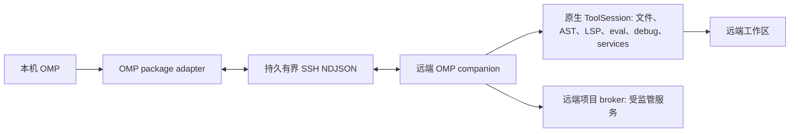

# OMP SSH Remote

简体中文 | [English](README.md)

OMP SSH Remote 将 Oh My Pi 控制面保留在本机，同时通过 SSH 在远端 Linux 主机的持久 companion 中执行有状态的 OMP 原生工作区工具。本 package 只适配 OMP。

## Runtime 边界

本机 OMP 继续负责 TUI、对话、模型凭据、session、Magic Context、`task`、`todo`、browser/computer、peer 消息以及后台任务簿记。每个 OMP session 使用一个独立远端 companion，持有远端文件系统、前台进程、hashline snapshot、AST proposal、LSP client、eval kernel、debugger session，以及该项目的受监管进程 broker。

远端原生工具：

`read`、`write`、`edit`、`bash`、`grep`、`glob`、`lsp`、`ast_grep`、`ast_edit`、`eval` 和 `debug`。

后台执行按归属划分，而不是按工具名划分：

- `bash async:true` 在本机当前 session 的 OMP job manager 中创建 job；原生 `wait` 和 job 的 `proc://` 查询、取消留在本机，命令在远端执行。独立根 session 不共用 manager；子代理使用各自 session family 的 manager。
- 带 `name` 的 `bash` 启动远端服务。服务 `proc://<name>` 的读写（包括 `/kill`、`/mode`）路由远端；原生进程根路径 `proc://` 和 `proc:///` 都合并两端列表。本机 job/agent 名称优先，启动时拒绝冲突名称。远端服务通过本机协调 job 接入原生 `wait`；断连令 job 失败，不回落到本机执行。
- `/remote-exit`、session 关闭或传输丢失时，companion 会停止本 session 启动的受监管进程；以 `persist` 或 `detached` 启动的进程按显式要求存活，与原生 OMP 一致。

普通非隔离子代理继承连接配置，但各自使用独立 companion。准入比较远端执行契约和原生工具 schema。`task isolated:true` 继续明确拒绝。顶层及批量条目的绝对 `taskFile` 路径均拒绝；本机任务文件请用 `local://`，因为 `task` 不读取远端文件。保留宿主原生审批规则；wrapper 在 session 初始化、首个模型请求前安装，不在连接时临时注册。

原生 worker-thread 子代理通过进程内 `BroadcastChannel` 访问主线程唯一权威的 family broker；通道只传递归属元数据和连接配置。每个子代理独立启动 SSH companion。共享撤销标记在 owner 退出时立即失效，即使关闭通知尚未送达，也不能迟到发布连接或执行工作区操作。原生 agent、job、审批和对话仍在本机；插件不修改 `task.workerThreads`。

Eval 的远端 `tool.*` 工具回调与顶层工具共用宿主调用路径：companion 发起调用请求，本机 OMP 执行原生审批及工具 hook，再由已注册的 remote wrapper 派发回远端。`tool.bash` 也走这条路径，继续接受宿主原生 Bash 审批。两个入口共用服务启动、显式停止和本机协调任务。每个回调只属于当前有效的 Eval 请求及工作区绑定，取消或更换连接后失效。除 `out://` 回复设备外，嵌套调用不能访问本机资源、递归调用 Eval 或暂存 AST 编辑；companion 不另建审批引擎。

服务在远端启动前先预留本机 job；本机容量满时不会先启动一个无人追踪的服务。启动期间的提前完成通知会保留。在等待就绪期间或成功启动后取消，都会等待本次服务实例清理；插话只结束就绪等待，不停止服务。worker 启动时确定唯一有效 owner，原生执行与退出清理共用；省略 session ID 时生成该 worker 独有的身份。

OMP 18.11 兼容：远端异步 Bash 转发实时和终态卡片更新，日志及 `wait` 仍由本机 job manager 管理。服务等待就绪期间观察所属 session 的 steering／peer 消息队列；插话只结束就绪等待，不停止服务。follow-up 和 `interruptMode: wait` 不触发提前返回。这里使用公开 session 事件，而非原生工具的私有 steering signal；没有 session 队列事件的隐藏内部 steering 不在桥接范围内。远端 `read`／`grep` 与 hashline `edit` 共享原生截断行保护：先用 `:raw` 读完整行再编辑。

显式停止服务成功后，根据原生 stop 回执结束本机协调任务。不会把主动停止当成自然退出：broker 对显式 stop 不发送 `daemon-completed`。停止失败时继续保留追踪。

OMP 18.12.3 审批保留本机原生文件／目录授权。远端使用哈希化的精确请求授权，按当前 binding、主机／用户／端口／密钥、目录和工具隔离，不能复用本机目录权限或另一台服务器的权限。重连／切换环境后失效；等待审批期间切换环境，会拒绝记录授权和执行旧请求。暂不提供远端整目录或跨 session 授权。审批提示保留原生工具给出的详情（命令、路径、内容）；路由到远端的调用另加一行 `Remote: <target>:<cwd>`，标明实际执行位置。

显式远端异步命令使用每个 job 独立的原生 shell。符合条件的前台调用按宿主的自动后台化阈值和插话规则切到后台，继续同一个请求及采集源，不重启命令。前台转后台保留 session shell 状态；立即后台启动则使用隔离的 job shell。本机 manager 不可用或满额时，普通命令保持前台执行。进程列表保留原生渲染元数据，多 URI 查询不允许混合本机和远端。

远端 Bash 的 `PI_SESSION_ID` 始终是所属会话 ID，包括隔离的后台作业。companion 不持有本机会话记录，因此 `PI_SESSION_FILE` 为空，不转发本机 transcript 路径。

远端 job 通过真实原生采集接入本机 `proc://<本机job-id>/streams[/<n>]` 和原生进度组件。管道数据在 `tail` 等下游命令处理前采集，不从累计工具预览反推。`out` 是原生清洗后的文本，不是任意 stdout/stderr 原始字节；管道源保留真实字节。留存有界：原生文本约 256 Ki UTF-16 单元，每条管道 1 MiB，仅保留最新四条已结束管道。传输保留真实偏移、缺失前缀和管道淘汰状态，原生缓冲区已经丢掉的数据不能补回。成功／失败结果结束前完成最后一轮留存数据同步；取消可打断阻塞的传输。远端的每请求 manager 只负责原生执行，公开 job ID、取消、`wait`、组件模型请求和凭据仍由本机管理。

组件遵循宿主 `async.widgets` 和 `widget` 模型角色配置。任务需要正在展示、运行足够久且有足够输出，短任务可能只有回退状态文字。生成规则可能增加本机模型请求，可用 `async.widgets: false` 关闭；不会在远端创建模型凭据或对话循环。

远端 eval 跟随原生 18.18.3，使用 `print` 或 JS `console.log`，不再使用已移除的 `display`。较大或多行的普通对象生成 JSON 视图，小对象仍是文本。表格、Markdown 和图像数据交给本机原生 renderer，不需要远端 UI；pandas 等库须已安装在远端。JSON 值、表头／单元格、Markdown、输出锚点和回显代码都是应用数据，原样保留；artifact 发布只适配原生拥有的输出元数据及精确生成的尾注，区分完整输出与有上限的首尾样本。URI 解析只针对 read／grep 的资源路径及已有 Bash 路径简写，不插值 write 正文、eval 源码或搜索模式。

Eval 本身就执行任意 JavaScript／Python，不是只读沙箱，也不是 `bash.patterns` 命令沙箱。原生 JS 的 `await sh(command, { cwd, timeout })` 和 Python 的 `sh(command, cwd=..., timeout=...)` 直接调用 worker 的内嵌 shell，不改写成 `tool.bash`，也不逐条请求宿主 Bash 审批。它们阻塞到命令完成，在独立于 Bash 工具的 session shell 中保留变量／函数；每次从远端 session cwd 或显式 cwd 开始，返回合并的 stdout／stderr，不做 Bash 输出精简或自动转后台。非零退出和命令超时抛出携带已捕获输出的 `ShellError`；取消 cell 会终止本次执行。原生破坏性 Git 操作保护仍然生效。helper 的准入限制不构成操作系统或进程级安全边界。

取消 JavaScript cell 会强制终止原生 JS worker。下一次 cell 会提示 kernel 已重启，并在新的 VM 中运行；此前的 JavaScript 变量、import 和定义须重新建立。这不同于 `sh` 命令自身超时：后者在 cell 内抛出可捕获的 `ShellError`。

`lsp.requestTimeout` 同样按秒转发，保留每次调用单独设置 timeout 的能力。

远端 Bash 的 `> out://`，以及前台 Eval 内的 `tool.write({path:"out://", ...})`／`tool.bash` 回复，使用原生 transcript 回复通道。连接时读取宿主的有效回复权限，包含显式 `out.enabled` 和原生 session 的实际 TUI 能力；子代理仍被拒绝。回复通过原生 `details.replies` 传输，不写入远端文件系统。`local://`、`skill://` 等其他本机资源不桥接到远端执行环境。远端 runtime 未提供的 extension／MCP 工具仍在本机执行，不作一刀切拦截。

连接期间明确拒绝用户直接 shell（`!`/`!!`）和 Python 快捷入口，避免静默执行本机命令；请使用远端 `bash`/`eval`，或退出连接后使用本机快捷入口。未适配的 `find`、`security_scan`、`ida`（包括 xdev 入口）仍明确拒绝。原生 `checkpoint`、`rewind` 留在本机并允许使用：只修改对话历史，不回滚远端项目文件或内核状态。远端 eval 支持计算、原生 `sh` 和远端工作区工具回调，不桥接本机 agent/workpool、judge/completion、archive、browser、todo；固定工作区说明解释此边界，本机编排请用顶层工具。

选中远端 runtime 时，原生 input hook 会拒绝 `/git`、`/security`、`/wt`（含 `/worktree`）、`/move`、`/add-dir`、`/remove-dir`、`/review`、`/annotate`、带原生 `--until` 或 `--while` shell 条件（含 `=` 写法）的 `/loop`，以及原生 `@path` 文件引用，因为这些入口会使用本机工作区或 shell。内置命令的冒号语法，以及启用 `input.bareSlashCommands` 后的裸命令词也在防护范围内。请改用远端 `bash`／`read`，文件路径去掉 `@`；不带 shell 条件的 `/loop` 仍可使用。此防护覆盖会发出原生 input 事件的 TUI 和 RPC 提交，不覆盖启动参数、print 模式或子代理 prompt，并非完整的本机执行隔离边界。

GitHub 仅保留明确的 API 查询操作；非搜索查询必须显式给出 `repo`，不从本机目录推断仓库。`pr_create`、`pr_checkout`、`pr_push` 和未知操作在远端模式下拒绝。

截断输出保存在远端 `~/.cache/omp-ssh-remote/artifacts/<namespace>`。连接到同一主机后，可用 `read` selector 或 `grep` 读取返回的 `remote-artifact://<namespace>/<id>`。远端 `bash` 与原生 `artifact://` 一样，经内嵌 shell 的只读 URL 文件系统解析这些引用：已审批的命令文本从不改写，外部程序拿到真实路径，写入会被拒绝。只有 worker 挂载该 scheme，宿主从不解析它。companion 正常退出时删除自己的 namespace，启动时清扫超过一小时且所属 worker 已不存在的 namespace；因此 transport 丢失遗留的 artifact 会过期，但永远不会复制到本机。本机 `artifact://` 仍保持本机语义。`xd://debug` 与直接 debug 一样在远端执行。

远端 read 登记的 Git 冲突返回 `remote-conflict://<binding>/<id>` 引用，可读取 `/ours`、`/theirs`、`/base`，或写入该引用解决远端冲突；批量写使用同一 binding 下的 `*`。裸 `conflict://` 仍属于本机会话。重连或退出后旧远端引用失效，须重新读取文件。edit 的执行域检查包含移动目的路径，跨域 `MV` 同样拒绝。

连接时会把固定白名单的执行域 settings 转发给 companion：`tools.maxTimeout/artifactMaxBytes`、`bash.gitGuard/direnv/direnvLoadTimeoutMs`、`display.shellVisualization`、`bashInterceptor.enabled/patterns`、`grep.context*`、`read.defaultLimit/renderMarkdown/summarize.*`、`images.autoResize`、`edit.fuzzyMatch/fuzzyThreshold/enforceSeenLines/blockAutoGenerated`、`lsp.formatOnWrite/diagnostics*`。取值来自宿主对本机项目的有效 settings。`display.shellVisualization` 保留原生 boolean 类型；关闭 Bash 的实时和最终 trace 不会关闭输出及管道捕获。`tools.artifactMaxBytes` 单位为 MiB，`0` 表示不限；配置上限时 artifact 保留首尾，而非保存全部输出字节。`bash.gitGuard` 在远端执行原生破坏性 Git 操作保护。companion 在内存中同时初始化工具和 shell settings，不加载远端项目配置，也不复制本机凭据。有效 `edit.mode` 在连接时单独协商，包含宿主模型和环境覆盖；远端 read 与 edit 使用同一编辑语言，并校验真实宿主的 schema 和 grammar。连接后宿主编辑模式改变时，须重连后才能继续远端读写编辑。其他结构性 key（`async.enabled`、`eval.*`、`memory.backend`、`skillful`）仍由 companion 固定，Bash 工具审批规则（`bash.patterns`、`bash.allowCompoundCommands`）在本机评估，不透传。`worktree.clone` 在远端固定关闭，保证 `git worktree add` 作为普通 git 执行，而不是被改写成 companion 自调用。每次调用都会带上本机当前激活的工具集，使 bash interceptor 只重定向到模型实际拥有的工具。



## 环境要求

- 本机 Linux 或 WSL，OMP `>=18.18.3`，并安装 Bun `1.4.4+`、npm、tar、OpenSSH 和 SCP；
- 远端为 glibc Linux `x86_64` 或 `aarch64`；
- 公钥 SSH 可在 batch mode 下登录；
- 远端项目目录已存在；
- 远端需要项目所需的 language server 和 debug adapter；Python／TypeScript 可显式启用下述私有 pack，不需要安装 Bun 或 OMP。

主机密钥使用严格校验。请通过正常的 OpenSSH `known_hosts` 信任主机，不要关闭 host checking。插件同时禁用 agent forwarding 和 SSH forwarding。

## 构建与安装

在仓库根目录执行：

```bash
bun install --frozen-lockfile
bun run build:omp
bun run build:worker:all
omp plugin link "$PWD/packages/omp"
```

package 必须包含：

```text
packages/omp/dist/extension.js
packages/omp/dist/worker-linux-x64
packages/omp/dist/worker-linux-x64.sha256
packages/omp/dist/worker-linux-arm64
packages/omp/dist/worker-linux-arm64.sha256
```

链接后重启 OMP。更新时重新构建 extension 和双架构 worker。停用、暂停或 reload 插件前，必须先执行 `/remote-exit`。OMP 18.12.6 的动态暂停不发送 shutdown，也没有暂停前回调；连接中直接暂停会恢复本机工具但可能保留旧 worker，插件无法在自己的 hook 一起被暂停后保证拦截或清理。

当前 companion 基于 OMP 18.18.3 构建，runtime contract 为 0.15.0。构建版本来自实际安装的源码及原生依赖，不取 PATH 中的 OMP 版本。更新 runtime 依赖或采集协议时，即使工具 schema 不变也需要重建双架构 worker。原生 addon 以逐文件 zstd 形式嵌入，首次使用时解包；构建缓存按架构、版本隔离。握手失败报告具体版本、编辑语言和 schema 差异。

上传显式使用 `scp -O`（SCP 协议），与远端目标路径的 shell 转义保持一致；OpenSSH 9+ 默认的 SFTP 会把这些引号当作文件名字符。本机 SCP 客户端须支持 `-O`。

## 连接与操作

可以使用标准 `~/.ssh/config` alias 或 OMP `/ssh add` 记录：

对于 `~/.ssh/config`，插件只从 `Host` 行发现具体别名，支持一行多个名称，不列出通配符和否定模式。连接时直接把别名交给 OpenSSH，不把 `HostName`、`User`、`Port` 或 `IdentityFile` 复制为命令行覆盖项。`Include`、`Match`、`ProxyCommand`、`ProxyJump` 等设置均由 OpenSSH 解析；只在 Include 文件中声明的别名也可以直接输入。

OMP `ssh.json` 中的主机记录是用户显式声明的插件覆盖配置：主机地址、用户、端口和密钥优先于 OpenSSH 配置，同时保留原别名用于原生 `Host` 匹配。显式 `--port` 和 `--identity` 参数优先于已保存的值。

```text
/remote-connect gpu-box /srv/project
/remote-status
/remote-reconnect [--force]
/remote-exit
```

显式形式：

```text
/remote-connect user@example.com /srv/project --port 22 --identity ~/.ssh/id_ed25519
```

目标也支持 IPv4、带或不带方括号的 IPv6，以及含 `+` 的用户名，例如 `developer+ci@[2001:db8::1]`。省略目录时使用远端 home。worker 自动选择并部署，不支持 `--worker`。

模型也可以通过 `remote_connect`、`remote_workspace_status`、`remote_reconnect` 和 `remote_exit` 执行相同生命周期。状态工具按需调用，报告进程内已知状态；它不会向每一轮注入 prompt，也不会主动 ping SSH。

连接时普通文件路径远端执行，本机内部 URI 保持本机归属，显式远端资源引用按 binding 分发。混合本机 URI 和远端路径的操作会被拒绝。连接失效后继续 fail-closed；每个 session 可用 `/remote-reconnect` 恢复自己的独立 transport，只有 owner 能执行 `/remote-exit` 恢复本机并关闭 family。reconnect 使用初次解析后的规范远端目录，丢弃该 companion 的 AST proposal；`--force` 替换仍显示为已连接的 transport，非持久服务不会自动重启。owner 重连不重启其他子会话的内核；子会话可单独重连。family 被强制关闭后，仍活动的后代保留不可用绑定，不得通过新 task 回落本机。

暴露远端执行能力前，插件会在原生 session transcript 中写入布尔型扩展记录。正常 shutdown 不清除此记录，对话 rewind 也不回滚它。进程重启后，曾选择远端的 session，以及其意图覆盖的恢复子代理，保持不可用，不得将工作区工具静默改为本机执行。该记录不保存目标、identity 文件、凭据或重连配置。恢复时先显式 `/remote-exit`，再 `/remote-connect <target> [cwd]`；无参数 reconnect 无法重建进程退出后丢失的配置。

升级时，若尚无布尔型意图记录，旧版 remote／unavailable 工作区通知只用于禁止本机执行，不恢复连接配置。即使后来曾出现旧版 local 通知，历史 session 也可能在升级后暂时不可用；显式 `/remote-exit` 会记录权威的本机选择，解除这项迁移限制。

## 可选私有 Python LSP Pack（原型）

Pack 固定为 **Node 22.22.0 + Pyright 1.1.407**，不修改全局 `PATH`，不在远端安装 npm、Node、Python 包或项目依赖。准备与启用部署都需要已有的 `python3`（仅标准库）；启动 server 使用 pack 内的 Node。支持 Linux glibc ARM64／x64 构建；产物构建通过不等于实际项目环境验收通过。

在仓库根目录仅准备要部署的架构：

```sh
bun scripts/prepare-python-lsp.ts arm64  # 或 x64
bun run build:omp
bun run build:worker:all
```

脚本只下载固定的官方 Node 和 npm Pyright 压缩包到忽略的本地 `.cache/`，核对 [Node 官方 SHA-256](https://nodejs.org/dist/v22.22.0/SHASUMS256.txt) 与 [Pyright npm SRI](https://registry.npmjs.org/pyright/1.1.407)，不运行包管理器安装脚本。输出 `packages/omp/dist/python-lsp-linux-<arch>.tar.gz` 及 `.json` descriptor；发布启用版本时将两者保留在 `extension.js` 旁。Pack 包含 `manifest.json`、`bin/node`、按物理位置定位的 `bin/pyright-langserver`、完整发布的 `pyright/` 运行时／资源／许可证，以及包含第三方声明的 `licenses/node-LICENSE`。Manifest 记录上游来源和逐文件 SHA-256／mode，其精确字节定义独立 pack ID；descriptor 另记 archive SHA-256。

仅在本机项目 `.omp/ssh.json` 或用户 `~/.omp/agent/ssh.json` 的指定 alias 显式启用，保留已有 SSH 字段：

```json
{"hosts":{"python-box":{"host":"example.com","lsp":{"python":true}}}}
```

通过该 alias 连接。未配置 opt-in 的连接及直接 `user@host` 保持原行为，不会为其他主机安装 server。本机产物缺失、远端缺少 Python 或最终缓存不完整／损坏时准备失败并报错，不静默降级为“已启用”。重连与子 worker 保留 opt-in，各自通过启动环境获得不可变路径，不改工具 schema／RPC 或全局 `PATH`。

首次连接通过现有严格 SSH／SCP 上传压缩包。远端标准库先核对 archive checksum 并拒绝绝对路径、路径穿越、链接及特殊成员，再解包并核对 manifest 文件／mode，在同哈希锁下原子发布到：

```text
~/.cache/omp-ssh-remote/language-packs/python/linux-<arch>/<pack-id>/
```

后续连接完整校验并复用，不重复上传。原型每次复用仍计算本机 archive 和远端全部文件哈希，有额外 I/O，不宣称 sidecar 快速路径。Pack **暂不自动 GC**，不参与 worker 的“两代”回收。损坏最终目录只拒绝，不覆盖、不递归删除；需要修复时停止使用者后由操作者仅处理报错的具体目录。

原生 LSP 的项目标记、惰性启动、定义／引用、编辑诊断与 reload 保持不变。项目本地／PATH server 优先；仅原生默认 Pyright 缺失时补充私有 launcher。显式 Pyright `command`、`disabled`、fileTypes／rootMarkers 不覆盖；显式选择的其他 Python 语义 server 即使命令缺失也不额外补 Pyright，已安装 basedpyright／pylsp／其他 Python 语义 server 同样优先，Ruff 单独存在不阻止补充。仅修改 Pyright settings 可使用 fallback。Worker 构建对 SDK **18.18.3** 的 config loader 做小范围编译期适配，版本或源码锚点变化即构建失败；不编辑安装的 OMP 源码、不 monkeypatch 运行时导出。

分析环境由远端已有 `pyrightconfig.json`／`pyproject.toml` 决定。需要显式指定远端解释器时，可自行在项目原生 `lsp.json` 中配置 settings，不设置 `command`：

```json
{"servers":{"pyright":{"settings":{"python":{"pythonPath":"/srv/project/.venv/bin/python"}}}}}
```

解释器必须已存在，路径属于远端项目；插件不扫描任意 venv、不自动写配置。通过原生 `lsp` status／reload，并对实际项目验证定义、引用、诊断；仅 server 启动不代表解释器和依赖解析正确。

## 可选私有 TypeScript LSP Pack

第二个 pack 与 Python 共用有界归档校验、manifest 锁、原子解包发布和完整缓存校验，仅必需文件 profile 不同。Python 原有 format-1 manifest、产物名称和内容 ID 保持兼容，不迁移或删除旧缓存。

固定版本为 **Node 22.22.0 + typescript-language-server 4.3.4 + TypeScript 5.8.3**。发布的 server 已打包运行时依赖，TypeScript 无 npm 运行时依赖；准备脚本遇到新增依赖边即拒绝，不解析浮动依赖树。官方 npm 压缩包按 SRI 固定（[server](https://registry.npmjs.org/typescript-language-server/4.3.4)、[TypeScript](https://registry.npmjs.org/typescript/5.8.3)），完整保留 server 的 Apache／MIT 声明、TypeScript 的 Apache／第三方声明及 Node 许可证汇总。不运行 npm install 或生命周期脚本。

```sh
bun scripts/prepare-typescript-lsp.ts arm64  # 或 x64
```

将 `packages/omp/dist/typescript-lsp-linux-<arch>.tar.gz` 和 `.json` 保留在 extension 旁，仅对本机 OMP SSH alias 启用：

```json
{"hosts":{"code-box":{"host":"example.com","lsp":{"typescript":true,"python":false}}}}
```

两个布尔值可分别省略，未知字段或非布尔值报错；这不是模型 `remote_connect` 参数。准备和部署需要已有的标准库 `python3`，启动时使用绝对路径的私有 Node，不修改 `PATH`。Worker 仅接收该连接的 `OMP_REMOTE_TYPESCRIPT_LSP_PACK`。首次发布到 `~/.cache/omp-ssh-remote/language-packs/typescript/linux-<arch>/<pack-id>/`，重连完整校验复用；pack 不参与 worker GC。

仅缺失的原生默认 `typescript-language-server` 使用私有 launcher。显式 command／disabled／fileTypes／rootMarkers 和自定义语义 server 优先，linter 不阻止语义 fallback。原生选择器仍检查项目／PATH `tsc` 版本：可用 TS7 优先，TS5 `tsc` 本身不是 LSP。TLS 内先采用显式初始化 `tsserver.path`，再选项目 TypeScript（包括支持的 PnP SDK 路径），最后才用内置版本，不强制覆盖项目版本。原生 `lsp` 动作、编辑诊断和 reload 共用原生客户端，不另建 LSP 实现；其他语言需要单独启用对应 pack。

私有 TLS 默认设置 `initOptions.disableAutomaticTypingAcquisition:true`，避免自动调用 npm 获取类型包；已有项目初始化选项优先，显式 `false` 会恢复上游行为，此时远端 npm／网络由项目自行提供。Tailwind、HTML／CSS 辅助 server 和 linter 不替代 TypeScript 语义 server，可与 fallback 并存。

写入／编辑的迟到诊断通过宿主原生 yield queue 交付，严格绑定所属会话和连接。保留原生去重，消费时根据版本拒绝过期结果。修改类工具串行执行至实际操作完成，并以文件内容修订覆盖原生 LSP／AST 未更新 mutation counter 的情况。取消仍会协作传递，但须等进行中的原生修改实际完成，才释放诊断交付屏障。

Worker 构建仅对 SDK 18.18.3 做严格锚点匹配的配置后备与修改完成适配，同时修正原生单文件／批量 writethrough 的完成判定：只承载格式化状态、尚未验证的诊断占位结果不能取消迟到诊断等待；已验证的行内正常／错误结果仍按原生方式完成。源码漂移即构建失败，不修改已安装的宿主 SDK。

## 可选私有 C/C++ LSP Pack

在本机 SSH alias 设置 `"lsp":{"cpp":true}`，与 Python／TypeScript 独立。运行 `bun scripts/prepare-cpp-lsp.ts arm64`（或 `x64`），将 `packages/omp/dist/cpp-lsp-linux-<arch>.{tar.gz,json}` 保留在 extension 旁。准备需要已有 `python3` 和 `readelf`，部署只需标准库 `python3`，不运行 apt／pip／npm 安装。

两个架构固定同一 **clangd 23.1.5** 官方 [apt.llvm.org](https://apt.llvm.org/) Focal 构建（2026-10-28，`a738f2737189`），并非独立发布的 23.1.0，也不是第三方 PyPI 二进制。`src/cpp-lsp-pack.ts` 保存精确包版本、URL、SHA-256、已验证签名的元数据哈希与签名指纹。固定版本审计时已验证 LLVM Release／Ubuntu InRelease；重新准备检查不可变包哈希，不依赖滚动更新的索引。当时 Focal 22 分支已无所需 ARM64 二进制。

包内仅保留 clangd、Clang 资源头文件、libclang-cpp、libLLVM 及私有动态依赖闭包。ARM64 额外包含 GCC C++／unwind 运行库；x64 还包含 ffi、edit、xml2、zlib／zstd、bsd／tinfo、ICU 和 lzma。每个 ELF 均检查架构与最高 **glibc 2.29** 符号要求，不捆绑 glibc 或系统 loader。保留各包版权声明、GCC 运行库例外和引用的完整通用许可证；LLVM 使用 Apache-2.0 with LLVM exceptions，依赖各自许可证不变。远端 OS／项目不安装任何包。

运行库固定于公开 Focal 仓库，不含 Ubuntu Pro／ESM 更新。[Focal 标准安全维护已于 2025 年 5 月结束](https://ubuntu.com/about/release-cycle)；来源认证与 ABI 兼容不保证包含当前安全修复。私有运行库仍需独立安全审查和版本更新，尤其在解析不受信任的项目之前。

复用通用 format-1 manifest、有界仅普通文件归档、完整缓存校验及原子发布，路径为 `~/.cache/omp-ssh-remote/language-packs/cpp/linux-<arch>/<pack-id>/`。仅所选 worker 接收 `OMP_REMOTE_CPP_LSP_PACK`；`bin/clangd` 用系统 loader 的显式私有库搜索路径与私有资源目录启动，不修改 `PATH` 或 `LD_LIBRARY_PATH`。Python／TypeScript 内容 ID 和缓存不变。

只为缺失的原生默认 clangd 补可执行文件；项目／PATH clangd、显式 command／disabled／fileTypes／rootMarkers 和 ccls 等语义替代配置优先，即使显式替代命令不可用也不新增重复 server。保留原生 `--background-index`／`--clang-tidy`／`--header-insertion=iwyu` 及文件类型；后台索引可能创建 clangd 常规项目缓存。不自动添加通配 `--query-driver`，执行项目编译器探测 include 必须由项目显式授权配置。

不提供标准库 SDK、编译器、厂商 SDK 或编译数据库。clangd 使用项目已有 `compile_commands.json`／`.clangd`，需要时可在原生 `lsp.json` 参数设置 `--compile-commands-dir=...`。应验证实际标准头文件和厂商 API，不能以 server 启动代替正确性。CUDA／Objective-C 文件类型仅继承原生选择，不代表捆绑其 SDK。

`cpp-lsp` smoke 始终运行 scratch C++ 检查。现有项目的只读验收由环境变量显式启用：`REMOTE_CPP_PROJECT_ROOT`（绝对路径）、`REMOTE_CPP_PROJECT_DATABASE`、`REMOTE_CPP_PROJECT_FILE`、`REMOTE_CPP_PROJECT_SYMBOL`、`REMOTE_CPP_PROJECT_LINE`、`REMOTE_CPP_PROJECT_DEFINITION_FILE`、`REMOTE_CPP_PROJECT_DEFINITION_LINE`、`REMOTE_CPP_PROJECT_REFERENCE_COUNT`。文件／数据库路径可为绝对路径或相对项目根目录的路径；行号从 1 开始，引用数量必须精确匹配；所选文件必须恰好有一条编译命令。诊断默认必须干净；如提供 `REMOTE_CPP_PROJECT_DIAGNOSTIC_PATTERN`（JavaScript 正则表达式），每条诊断都必须匹配，缺失头文件仍必定失败。验收使用包内 clangd，关闭后台索引，只在 scratch 写配置，并校验源文件、定义文件及数据库哈希未变。

## 部署与安全

adapter 探测远端平台和 home，选择 package 自带的对应 worker，校验本机 SHA-256 sidecar，用 `scp -C` 压缩上传到 UUID 临时路径，在远端复核 SHA-256 后原子启用到：

```text
~/.cache/omp-ssh-remote/omp-1/<sha256>/worker-linux-<arch>
```

连接／重连在原生握手通过后，记录单调递增的最近使用序号，并跨 namespace 清理已托管 worker。默认保留 **两个不同 worker 哈希**：刚使用的构建及最近使用的另一个构建。重复使用不新增一代，回滚会更新使用顺序。同哈希的多份目录按副本单独计数。仍有租约的构建和副本额外保留，因此长期运行时可能超过两个；下次成功连接继续清理。

部署从上传前到握手结束持有共享版本租约，再交接给 worker 生命周期租约。缓存根目录的同一把 `flock` 串行化元数据提交、启用及清理；删除须取得非阻塞独占版本租约，并检查旧进程的 `/proc`。只有严格匹配原生所有权 manifest 且直属内容全部可识别的目录可删除，共享 companion 目标不删除。首次仅迁移既有 `omp-1` 无 companion 布局且校验标记匹配的目录，初始顺序明确来自目录 mtime，并非恢复的历史使用记录。未登记的失败部署、未知 namespace（包括数字版本目录）、损坏元数据和陌生文件保持不动；不执行旧二进制，也不对所有缓存重新计算哈希。

成功连接报告保留的不同构建及副本、删除副本及完全移除的构建哈希、忙碌豁免和未分类哈希目录候选数。大小为普通、非符号链接 worker 二进制的**已分配磁盘字节数之和**，不是逻辑大小或整个缓存占用；共享资产不计入。提交及清理总预算 10 秒，失败报告不可用而非零占用。上传或握手失败不推进使用序号。status 不访问 SSH，只展示该带时间戳快照。协议 frame 上限 16 MiB，部署输出上限 1 MiB；SSH 保持 batch mode、严格 host checking、`ForwardAgent=no` 和 `ClearAllForwardings=yes`，断连不回退本机执行。`nohup`、`setsid` 等主动脱离监管的进程仍不受管理。

连接界面显示探测、缓存检查、上传、激活阶段。`remote_connect` 和 `remote_reconnect` 工具都响应调用取消，`/remote-exit` 可取消进行中的命令部署。同一扩展实例内的同主机部署串行执行并重新检查缓存，避免重复上传；上传失败后在 SSH 可达时尽力清理临时文件。每次连接重新采集当前宿主的工具契约，避免复用其他模型或 session 的握手。

## 已验证性能

2026 年 10 月，OMP 18.9.1、Linux x86_64 验收主机、缓存 worker 与持久 SSH ControlMaster；交错测量 10 次 echo/read/bash，包含首调用：

| 操作 | 中位数 |
| --- | --- |
| 持久 SSH echo 往返 | `8.02 ms` |
| 远端 read | `24.63 ms` |
| 前台 Bash | `17.01 ms` |

worker 初始化 `2439 ms`。另一次首次上传／部署耗时 `88.36 s`，该轮 read/bash 中位数约 `0.8 s`，后续交错对照测量恢复到上表水平。这不是受控的前后加速对比，也不是当前版本的性能或内存测量。ARM64 仅完成构建验证，未进行实机性能验收。

### 0.13.1 本机受控对照

Linux x86_64、Bun 1.4.4、OMP 18.15.0 下，以独立新进程、热文件缓存交错运行三组前后对照。语言包仍完整校验 manifest 中所有文件、权限和摘要，仅改为有界分块哈希。同一 C++ 包（345 个文件、287,392,119 字节）的完整 Python 缓存校验，中位峰值 RSS **166.13 → 22.04 MiB**，耗时 **271.79 → 202.46 ms**；本机压缩包哈希（87,563,069 字节）峰值 RSS **115.71 → 69.21 MiB**，耗时 **76.49 → 64.15 ms**。这是校验瞬时开销，不是 worker 常驻内存或 SSH 延迟。

另一组编译产物对照将两版依次放到同一可执行路径，启动真实 companion、可复用 JS 内核和就绪服务；每轮同时采样六次，再取三组交错对照的中位数。三个进程合计 PSS **488.77 → 417.54 MiB**；已初始化 JS 为 **145.50 → 102.89 MiB**，运行中 broker 为 **148.05 → 112.90 MiB**。companion RSS 基本不变（**246.19 → 246.45 MiB**），PSS 反而 **195.20 → 201.34 MiB**，部分受共享页分摊影响，不能宣称主 worker 节省内存。首次 JS／服务请求中位耗时 **705.43 → 550.72 ms／781.67 → 626.27 ms**，热请求没有证明改善。不改变子进程状态或清理语义，未测量大项目 LSP 内存或远端网络性能。


## 提示缓存稳定性

连接、断开、重连只切换执行绑定，不改变工具列表或描述。`remote_workspace_status` 的固定说明讲清路由规则、远端限制和何时查状态。保留原生审批和渲染，不替换其他插件拥有的工具。启动时没有绑定的工具在远端明确拒绝，不通过重连临时注册。

绑定变化在下一次 `before_agent_start` 进入原生消息历史，发生在 MC 等 context transform 之前；不额外启动模型回合，不在 `context` 后追加或重放私有锚点。以当前原生分支中实际接纳的消息为公告依据，包括落盘的 `custom_message` entry；hook 返回通知不代表已公告。新本地会话不增加环境消息，已接纳且未变化的状态不重复提醒，准备过程取消后可重发。冷恢复和 resume 说明当前绑定，不自动连接 SSH；持久化的远端意图表示不可用，而非本机。对话分支历史不覆盖该意图。压缩后可在下一次用户回合重新说明远端绑定。切换期间的调用不会在新环境重试，过期结果和更新会被拒绝或抑制。

`scripts/smoke-cache.ts` 在真实 OMP 中使用本地 HTTP 接收端和合成回复，对比本机、连接、重连、断开前后的实际序列化工具、系统消息和完整历史前缀，同时通过 SSH 执行真实工作区命令。它验证前缀相等，**不伪造供应商 cached tokens 或费用节省数字**。可复现命令见 [English README](README.md#prompt-cache-stability)。

MC 组合验收另用 `cache-mc`：先加载实际安装的 MC 兼容扩展，再加载 remote，保留 MC context transform 和 dispatch fence，逐轮要求恰好一次真实本地 HTTP 请求。MC 自己的重新编号不算 remote 前缀不一致。用 `bun scripts/build-smoke.ts cache-mc` 构建，再执行 `CACHE_SMOKE_MC_COMPAT=/path/to/omp-mc-compat/index.js REMOTE_CONNECT_ARGS='gpu-box /tmp' bun scripts/run-smoke.ts cache-mc`。辅助模型调用已关闭，配置、session、数据库和日志使用隔离临时目录；设置 `SMOKE_KEEP_ARTIFACTS=1` 可保留核验材料。连接中动态暂停扩展不受支持，必须先退出 remote，再禁用或 reload。

默认使用原生 Chat Completions；加上 `CACHE_SMOKE_API=openai-responses` 可验证 Responses 端点与解析器，生成带编号及 opaque reasoning 的消息，检查回放顺序、phase、加密 payload 和旧编号清理。输出 ID 在落盘 native history 中保留；HTTP input 则遵循 OMP 原生清洗规则，可能删除这些输出 ID，不能混为一谈。

`scripts/smoke-lifecycle.ts` 另行验证真实文件／编辑／计算／artifact、异步输出卡片与原生 `wait`、服务插话、主动停止追踪、自然退出状态和本机恢复。用 `bun scripts/build-smoke.ts lifecycle` 构建，再执行 `REMOTE_CONNECT_ARGS='gpu-box /tmp' bun scripts/run-smoke.ts lifecycle`。结束后删除生成的 bundle。

`scripts/smoke-capture.ts` 验证 `tail` 前的真实字节、原生组件的数值及渲染、自动后台化不重启命令、session／隔离 shell、取消，以及断连后的本机留存数据。只替换模型边界为固定 author，规格校验、数据摄取和渲染均使用原生实现；不会调用供应商。用 `bun scripts/build-smoke.ts capture` 构建，再执行 `REMOTE_CONNECT_ARGS='gpu-box /tmp' bun scripts/run-smoke.ts capture`。runner 自动创建短阈值的临时配置，不修改用户配置。

`scripts/smoke-rich-output.ts` 对照真实本机与 SSH 原生结果，验证 JSON、表格、Markdown、有效 PNG、字面 URI、写读／搜索／查询及输出锚点。用 `bun scripts/build-smoke.ts rich-output` 构建，再执行 `REMOTE_CONNECT_ARGS='gpu-box /tmp' bun scripts/run-smoke.ts rich-output`；不需要模型请求或额外 Python 包。结束后删除生成的 bundle。直接运行 `bun scripts/build-smoke.ts` 可将六个验收 helper 一起构建到已被 git 忽略的 `.cache/smoke/`，不进入发布包；helper 加载 `packages/omp/dist/` 中的扩展，worker 路径解析保持不变。

runner 先通过 RPC `get_available_commands` 验证扩展命令注册，再在同一 session 中提交验收命令；命令缺失时不会发送 prompt。超时预算包含首次上传，缓存命中后可排除部署耗时。成功时删除临时 session，失败时保留供定位。

运行已构建的 helper 时可加 `SMOKE_ADMISSION_ONLY=1`，只验证真实编译版 OMP 能加载并注册扩展，不提交 prompt、不调用供应商、不连接 SSH。它检查宿主实际公开的模块边界；源码 import 和 bundle 构建成功不能替代这项检查。

升级或 reload 插件本身可能引起一次初始前缀变化。模型／配置切换、其他插件、上下文压缩以及供应商缓存过期不属于连接切换保证。缓存前缀稳定机制本身只需构建本机扩展；更新 runtime 依赖或协议时仍须重新构建并部署 companion 二进制。

## 限制

- 仅支持 Linux glibc x86_64 和 ARM64；
- OMP `>=18.18.3`，且 companion schema 匹配；
- 会话以 `edit.mode=none` 启动时不暴露 Edit；之后启用须重启会话，既有未绑定工具门控会阻止执行，不回退本机；
- 远端须有 util-linux 的 `flock`，用于保护活跃 worker 可执行文件；
- 支持显式 async Bash 和符合条件的自动后台化，不桥接交互 Bash PTY；
- 不支持远端图像问答（`?q=`）；请直接读取图像，将像素交给模型；
- `tools.restrictedFolders` 适用于原生本机资源，尚未实现远端文件系统的目录限制审批；
- 保留原生宿主审批及 enabled-tool 门控，但 SDK 18.18.3 的公开 AgentSession API 不暴露有效 `ToolSession.lspReadOnly`／`deviceOnlyWrite` 策略，无法镜像这些字段的显式会话级覆盖；不要将此版本当作只读沙箱。AgentRef 的只读历史元数据不是执行策略。
- 不支持 `task isolated:true` 远端 worktree；
- 不支持远端到本机 artifact bridge；
- 白名单之外的 settings 在 companion 中保持编译默认值，不提供任意 settings 透传；
- 每个 session 或子代理各占一个 companion 进程；并发子代理各消耗一条 SSH 通道和一个 worker 进程；
- 连接时会停放当前 session 的同线程空闲子代理；再次发消息时会重建其 session 并绑定远端。已有的存活 worker-thread 子代理须先停止再连接，因为插件无法原子完成跨线程唤醒／停放准入。连接后新建的 worker-thread 子代理正常继承远端。worker-thread session 不能独立创建远端 family：请先在主 session 连接。同线程停放保留原生空闲 TTL 的待处理 IRC 竞态；尚无 transcript 且父链指向 owner 的子代理保守地视为运行中。
- 单个输出 frame 不能超过 16 MiB；
- 宿主 Git 状态／overlay 和状态栏 Git 信息描述本机仓库，而非绑定的远端工作区；
- 计划自动保存（`plan.autosave`）写入本机 `.omp/plans/`；
- `/clear` 和提示刷新会重新读取本机项目上下文文件；
- 原生 hooks 和 `pi.exec` 在本机执行；
- 远端 Bash 自动转入后台后仍可能接受 `out://`，与原生后台执行不同；
- 远端 AST 预览不执行原生待处理预览的提醒和升级约束；
- 连接和每轮开始前会拒绝 Cursor 模型及当前使用 Cursor 的 advisor。经 `tool_call` 的 advisor 工作区调用会被阻止，但 Cursor advisor 的直接操作绕过该 hook；后续 advisor 模型变化不受持续门控，绑定期间不支持此类用法；
- 启用 autoresearch 工具时拒绝连接；原生未暴露私有的实验运行状态，请先关闭 autoresearch 并等待已有实验停止；
- browser、desktop、模型凭据、memory 和本机 session 控制面不进入远端。

在 Bun 1.4.4／Linux 上，原生 worker-thread 突然退出后，已退出的本机 SSH 子进程可能以僵尸状态（`Z`）保留至父 OMP 进程退出。实际验收确认 SSH stdin 已关闭，远端 companion 及其非持久服务均已退出，并非远端活跃进程泄漏。不含 SSH、也不加载插件的隔离实验分别使用 `node:child_process.spawn` 和 `Bun.spawn` 复现了该行为；更换 spawn 接口不能解决。正常停放／恢复验收通过。未新增监督进程或回收器，也未修改 `task.workerThreads`。
