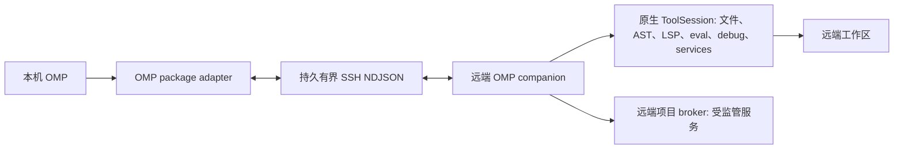

# OMP SSH Remote

简体中文 | [English](README.md)

OMP SSH Remote 将 Oh My Pi 控制面保留在本机，同时通过 SSH 在远端 Linux 主机的持久 companion 中执行有状态的 OMP 原生工作区工具。本 package 只适配 OMP。

## Runtime 边界

本机 OMP 继续负责 TUI、对话、模型凭据、session、Magic Context、`task`、`todo`、browser/computer、peer 消息以及后台任务簿记。每个 OMP session 使用一个独立远端 companion，持有远端文件系统、前台进程、hashline snapshot、AST proposal、LSP client、eval kernel、debugger session，以及该项目的受监管进程 broker。

远端原生工具：

`read`、`write`、`edit`、`bash`、`grep`、`glob`、`lsp`、`ast_grep`、`ast_edit`、受限 `eval` 和 `debug`。

后台执行按归属划分，而不是按工具名划分：

- `bash async:true` 在本机当前 session 的 OMP job manager 中创建 job；原生 `wait` 和 job 的 `proc://` 查询、取消留在本机，命令在远端执行。独立根 session 不共用 manager；子代理使用各自 session family 的 manager。
- 带 `name` 的 `bash` 启动远端服务。服务 `proc://<name>` 的读写（包括 `/kill`、`/mode`）路由远端；原生进程根路径 `proc://` 和 `proc:///` 都合并两端列表。本机 job/agent 名称优先，启动时拒绝冲突名称。远端服务通过本机协调 job 接入原生 `wait`；断连令 job 失败，不回落到本机执行。
- `/remote-exit`、session 关闭或传输丢失时，companion 会停止本 session 启动的受监管进程；以 `persist` 或 `detached` 启动的进程按显式要求存活，与原生 OMP 一致。

普通非隔离子代理继承连接配置，但各自使用独立 companion。准入比较远端执行契约和原生工具 schema。`task isolated:true` 继续明确拒绝。保留宿主原生审批规则；wrapper 在 session 初始化、首个模型请求前安装，不在连接时临时注册。

Eval 的远端工具回调与顶层工具共用宿主调用路径：companion 发起调用请求，本机 OMP 执行原生审批及工具 hook，再由已注册的 remote wrapper 派发回远端。两个入口共用服务启动、显式停止和本机协调任务。每个回调只属于当前有效的 Eval 请求及工作区绑定，取消或更换连接后失效。嵌套调用不能访问本机资源、递归调用 Eval 或暂存 AST 编辑；companion 不另建审批引擎。

服务在远端启动前先预留本机 job；本机容量满时不会先启动一个无人追踪的服务。启动期间的提前完成通知会保留。在等待就绪期间或成功启动后取消，都会等待本次服务实例清理；插话只结束就绪等待，不停止服务。worker 启动时确定唯一有效 owner，原生执行与退出清理共用；省略 session ID 时生成该 worker 独有的身份。

OMP 18.11 兼容：远端异步 Bash 转发实时和终态卡片更新，日志及 `wait` 仍由本机 job manager 管理。服务等待就绪期间观察所属 session 的 steering／peer 消息队列；插话只结束就绪等待，不停止服务。follow-up 和 `interruptMode: wait` 不触发提前返回。这里使用公开 session 事件，而非原生工具的私有 steering signal；没有 session 队列事件的隐藏内部 steering 不在桥接范围内。远端 `read`／`grep` 与 hashline `edit` 共享原生截断行保护：先用 `:raw` 读完整行再编辑。

显式停止服务成功后，根据原生 stop 回执结束本机协调任务。不会把主动停止当成自然退出：broker 对显式 stop 不发送 `daemon-completed`。停止失败时继续保留追踪。

OMP 18.12.3 审批保留本机原生文件／目录授权。远端使用哈希化的精确请求授权，按当前 binding、主机／用户／端口／密钥、目录和工具隔离，不能复用本机目录权限或另一台服务器的权限。重连／切换环境后失效；等待审批期间切换环境，会拒绝记录授权和执行旧请求。暂不提供远端整目录或跨 session 授权。

显式远端异步命令使用每个 job 独立的原生 shell。符合条件的前台调用按宿主的自动后台化阈值和插话规则切到后台，继续同一个请求及采集源，不重启命令。前台转后台保留 session shell 状态；立即后台启动则使用隔离的 job shell。本机 manager 不可用或满额时，普通命令保持前台执行。进程列表保留原生渲染元数据，多 URI 查询不允许混合本机和远端。

远端 Bash 的 `PI_SESSION_ID` 始终是所属会话 ID，包括隔离的后台作业。companion 不持有本机会话记录，因此 `PI_SESSION_FILE` 为空，不转发本机 transcript 路径。

远端 job 通过真实原生采集接入本机 `proc://<本机job-id>/streams[/<n>]` 和原生进度组件。管道数据在 `tail` 等下游命令处理前采集，不从累计工具预览反推。`out` 是原生清洗后的文本，不是任意 stdout/stderr 原始字节；管道源保留真实字节。留存有界：原生文本约 256 Ki UTF-16 单元，每条管道 1 MiB，仅保留最新四条已结束管道。传输保留真实偏移、缺失前缀和管道淘汰状态，原生缓冲区已经丢掉的数据不能补回。成功／失败结果结束前完成最后一轮留存数据同步；取消可打断阻塞的传输。远端的每请求 manager 只负责原生执行，公开 job ID、取消、`wait`、组件模型请求和凭据仍由本机管理。

组件遵循宿主 `async.widgets` 和 `widget` 模型角色配置。任务需要正在展示、运行足够久且有足够输出，短任务可能只有回退状态文字。生成规则可能增加本机模型请求，可用 `async.widgets: false` 关闭；不会在远端创建模型凭据或对话循环。

远端 eval 跟随原生 18.12.3，使用 `print` 或 JS `console.log`，不再使用已移除的 `display`。较大或多行的普通对象生成 JSON 视图，小对象仍是文本。表格、Markdown 和图像数据交给本机原生 renderer，不需要远端 UI；pandas 等库须已安装在远端。JSON 值、表头／单元格、Markdown、输出锚点和回显代码都是应用数据，原样保留；artifact 发布只适配原生拥有的输出元数据及精确生成的尾注，区分完整输出与有上限的首尾样本。URI 解析只针对 read／grep 的资源路径及已有 Bash 路径简写，不插值 write 正文、eval 源码或搜索模式。

`lsp.requestTimeout` 同样按秒转发，保留每次调用单独设置 timeout 的能力。

连接期间明确拒绝用户直接 shell（`!`/`!!`）和 Python 快捷入口，避免静默执行本机命令；请使用远端 `bash`/`eval`，或退出连接后使用本机快捷入口。未适配的 `find`、`security_scan`、`ida`（包括 xdev 入口）仍明确拒绝。原生 `checkpoint`、`rewind` 留在本机并允许使用：只修改对话历史，不回滚远端项目文件或内核状态。远端 eval 只支持计算和远端工作区工具回调，不桥接本机 agent/workpool、judge/completion、archive、browser、todo；固定工作区说明解释此边界，本机编排请用顶层工具。

GitHub 仅保留明确的 API 查询操作；非搜索查询必须显式给出 `repo`，不从本机目录推断仓库。`pr_create`、`pr_checkout`、`pr_push` 和未知操作在远端模式下拒绝。

截断输出保存在远端 `~/.cache/omp-ssh-remote/artifacts/<namespace>`。连接到同一主机后，可用 `read` selector 或 `grep` 读取返回的 `remote-artifact://<namespace>/<id>`。companion 正常退出时删除自己的 namespace，启动时清扫超过一小时且所属 worker 已不存在的 namespace；因此 transport 丢失遗留的 artifact 会过期，但永远不会复制到本机。本机 `artifact://` 仍保持本机语义。`xd://debug` 与直接 debug 一样在远端执行。

远端 read 登记的 Git 冲突返回 `remote-conflict://<binding>/<id>` 引用，可读取 `/ours`、`/theirs`、`/base`，或写入该引用解决远端冲突；批量写使用同一 binding 下的 `*`。裸 `conflict://` 仍属于本机会话。重连或退出后旧远端引用失效，须重新读取文件。edit 的执行域检查包含移动目的路径，跨域 `MV` 同样拒绝。

连接时会把固定白名单的执行域 settings 转发给 companion：`tools.maxTimeout/artifactMaxBytes`、`bash.gitGuard/direnv/direnvLoadTimeoutMs`、`bashInterceptor.enabled/patterns`、`grep.context*`、`read.defaultLimit/renderMarkdown/summarize.*`、`images.autoResize`、`edit.fuzzyMatch/fuzzyThreshold/enforceSeenLines/blockAutoGenerated`、`lsp.formatOnWrite/diagnostics*`。取值来自宿主对本机项目的有效 settings。`tools.artifactMaxBytes` 单位为 MiB，`0` 表示不限；配置上限时 artifact 保留首尾，而非保存全部输出字节。`bash.gitGuard` 在远端执行原生破坏性 Git 操作保护。companion 在内存中同时初始化工具和 shell settings，不加载远端项目配置，也不复制本机凭据。有效 `edit.mode` 在连接时单独协商，包含宿主模型和环境覆盖；远端 read 与 edit 使用同一编辑语言，并校验真实宿主的 schema 和 grammar。连接后宿主编辑模式改变时，须重连后才能继续远端读写编辑。其他结构性 key（`async.enabled`、`eval.*`、`memory.backend`、`skillful`）仍由 companion 固定，审批规则（`bash.patterns`、`bash.allowCompoundCommands`）在本机评估，不透传。`worktree.clone` 在远端固定关闭，保证 `git worktree add` 作为普通 git 执行，而不是被改写成 companion 自调用。每次调用都会带上本机当前激活的工具集，使 bash interceptor 只重定向到模型实际拥有的工具。



## 环境要求

- 本机 Linux 或 WSL，OMP `>=18.13.1`，并安装 Bun `1.3.14+`、npm、tar、OpenSSH 和 SCP；
- 远端为 glibc Linux `x86_64` 或 `aarch64`；
- 公钥 SSH 可在 batch mode 下登录；
- 远端项目目录已存在；
- 远端需要安装项目所需的 language server 和 debug adapter，但不需要安装 Bun 或 OMP。

主机密钥使用严格校验。请通过正常的 OpenSSH `known_hosts` 信任主机，不要关闭 host checking。插件同时禁用 agent forwarding 和 SSH forwarding。

## 构建与安装

在仓库根目录执行：

```bash
bun install --frozen-lockfile
bun run build:omp
bun run build:worker:all
omp plugin link "$PWD/packages/omp"
```

package 必须包含：

```text
packages/omp/dist/extension.js
packages/omp/dist/worker-linux-x64
packages/omp/dist/worker-linux-x64.sha256
packages/omp/dist/worker-linux-arm64
packages/omp/dist/worker-linux-arm64.sha256
```

链接后重启 OMP。更新时重新构建 extension 和双架构 worker。停用、暂停或 reload 插件前，必须先执行 `/remote-exit`。OMP 18.12.6 的动态暂停不发送 shutdown，也没有暂停前回调；连接中直接暂停会恢复本机工具但可能保留旧 worker，插件无法在自己的 hook 一起被暂停后保证拦截或清理。

当前 companion 基于 OMP 18.13.1 构建，runtime contract 为 0.14.0。构建版本来自实际安装的源码及原生依赖，不取 PATH 中的 OMP 版本。更新 runtime 依赖或采集协议时，即使工具 schema 不变也需要重建双架构 worker。原生 addon 以逐文件 zstd 形式嵌入，首次使用时解包；构建缓存按架构、版本隔离。握手失败报告具体版本、编辑语言和 schema 差异。

上传显式使用 `scp -O`（SCP 协议），与远端目标路径的 shell 转义保持一致；OpenSSH 9+ 默认的 SFTP 会把这些引号当作文件名字符。本机 SCP 客户端须支持 `-O`。

## 连接与操作

可以使用标准 `~/.ssh/config` alias 或 OMP `/ssh add` 记录：

已配置的别名会保留为 SSH／SCP 的目标名称以匹配 `Host`，实际主机地址、用户、端口和密钥仍按解析后的连接配置选择。因此仅写在别名下的 `ProxyCommand`、`ProxyJump` 等 OpenSSH 设置会应用到探测、上传和 worker 连接，不必额外添加 IP 地址的 `Host` 条目。

```text
/remote-connect gpu-box /srv/project
/remote-status
/remote-reconnect [--force]
/remote-exit
```

显式形式：

```text
/remote-connect user@example.com /srv/project --port 22 --identity ~/.ssh/id_ed25519
```

模型也可以通过 `remote_connect`、`remote_workspace_status`、`remote_reconnect` 和 `remote_exit` 执行相同生命周期。状态工具按需调用，报告进程内已知状态；它不会向每一轮注入 prompt，也不会主动 ping SSH。

连接时普通文件路径远端执行，本机内部 URI 保持本机归属，显式远端资源引用按 binding 分发。混合本机 URI 和远端路径的操作会被拒绝。连接失效后继续 fail-closed；每个 session 可用 `/remote-reconnect` 恢复自己的独立 transport，只有 owner 能执行 `/remote-exit` 恢复本机并关闭 family。reconnect 使用初次解析后的规范远端目录，丢弃该 companion 的 AST proposal；`--force` 替换仍显示为已连接的 transport，非持久服务不会自动重启。owner 重连不重启其他子会话的内核；子会话可单独重连。family 被强制关闭后，仍活动的后代保留不可用绑定，不得通过新 task 回落本机。

## 部署与安全

adapter 探测远端平台和 home，选择 package 自带的对应 worker，校验本机 SHA-256 sidecar，用 `scp -C` 压缩上传到 UUID 临时路径，在远端复核 SHA-256 后原子启用到：

```text
~/.cache/omp-ssh-remote/omp-1/<sha256>/worker-linux-<arch>
```

连接／重连在原生握手通过后，记录单调递增的最近使用序号，并跨 namespace 清理已托管 worker。默认保留 **两个不同 worker 哈希**：刚使用的构建及最近使用的另一个构建。重复使用不新增一代，回滚会更新使用顺序。同哈希的多份目录按副本单独计数。仍有租约的构建和副本额外保留，因此长期运行时可能超过两个；下次成功连接继续清理。

部署从上传前到握手结束持有共享版本租约，再交接给 worker 生命周期租约。缓存根目录的同一把 `flock` 串行化元数据提交、启用及清理；删除须取得非阻塞独占版本租约，并检查旧进程的 `/proc`。只有严格匹配原生所有权 manifest 且直属内容全部可识别的目录可删除，共享 companion 目标不删除。首次仅迁移既有 `omp-1` 无 companion 布局且校验标记匹配的目录，初始顺序明确来自目录 mtime，并非恢复的历史使用记录。未登记的失败部署、未知 namespace（包括数字版本目录）、损坏元数据和陌生文件保持不动；不执行旧二进制，也不对所有缓存重新计算哈希。

成功连接报告保留的不同构建及副本、删除副本及完全移除的构建哈希、忙碌豁免和未分类哈希目录候选数。大小为普通、非符号链接 worker 二进制的**已分配磁盘字节数之和**，不是逻辑大小或整个缓存占用；共享资产不计入。提交及清理总预算 10 秒，失败报告不可用而非零占用。上传或握手失败不推进使用序号。status 不访问 SSH，只展示该带时间戳快照。协议 frame 上限 16 MiB，部署输出上限 1 MiB；SSH 保持 batch mode、严格 host checking、`ForwardAgent=no` 和 `ClearAllForwardings=yes`，断连不回退本机执行。`nohup`、`setsid` 等主动脱离监管的进程仍不受管理。

连接界面显示探测、缓存检查、上传、激活阶段。`remote_connect` 和 `remote_reconnect` 工具都响应调用取消，`/remote-exit` 可取消进行中的命令部署。同一扩展实例内的同主机部署串行执行并重新检查缓存，避免重复上传；上传失败后在 SSH 可达时尽力清理临时文件。每次连接重新采集当前宿主的工具契约，避免复用其他模型或 session 的握手。

## 已验证性能

2026 年 10 月，OMP 18.9.1、Linux x86_64 验收主机、缓存 worker 与持久 SSH ControlMaster；交错测量 10 次 echo/read/bash，包含首调用：

| 操作 | 中位数 |
| --- | --- |
| 持久 SSH echo 往返 | `8.02 ms` |
| 远端 read | `24.63 ms` |
| 前台 Bash | `17.01 ms` |

worker 初始化 `2439 ms`。另一次首次上传／部署耗时 `88.36 s`，该轮 read/bash 中位数约 `0.8 s`，后续交错对照测量恢复到上表水平。这不是受控的前后加速对比，也不是当前版本的性能或内存测量。ARM64 仅完成构建验证，未进行实机性能验收。

## 提示缓存稳定性

连接、断开、重连只切换执行绑定，不改变工具列表或描述。`remote_workspace_status` 的固定说明讲清路由规则、远端限制和何时查状态。保留原生审批和渲染，不替换其他插件拥有的工具。启动时没有绑定的工具在远端明确拒绝，不通过重连临时注册。

绑定变化在下一次 `before_agent_start` 进入原生消息历史，发生在 MC 等 context transform 之前；不额外启动模型回合，不在 `context` 后追加或重放私有锚点。以当前原生分支中实际接纳的消息为公告依据，包括落盘的 `custom_message` entry；hook 返回通知不代表已公告。新本地会话不增加环境消息，已接纳且未变化的状态不重复提醒，准备过程取消后可重发。冷恢复、resume 和分支导航都会把旧远端历史纠正为当前本机环境，不自动恢复 SSH。压缩后可在下一次用户回合重新说明远端绑定。切换期间的调用不会在新环境重试，过期结果和更新会被拒绝或抑制。

`scripts/smoke-cache.ts` 在真实 OMP 中使用本地 HTTP 接收端和合成回复，对比本机、连接、重连、断开前后的实际序列化工具、系统消息和完整历史前缀，同时通过 SSH 执行真实工作区命令。它验证前缀相等，**不伪造供应商 cached tokens 或费用节省数字**。可复现命令见 [English README](README.md#prompt-cache-stability)。

MC 组合验收另用 `cache-mc`：先加载实际安装的 MC 兼容扩展，再加载 remote，保留 MC context transform 和 dispatch fence，逐轮要求恰好一次真实本地 HTTP 请求。MC 自己的重新编号不算 remote 前缀不一致。用 `bun scripts/build-smoke.ts cache-mc` 构建，再执行 `CACHE_SMOKE_MC_COMPAT=/path/to/omp-mc-compat/index.js REMOTE_CONNECT_ARGS='gpu-box /tmp' bun scripts/run-smoke.ts cache-mc`。辅助模型调用已关闭，配置、session、数据库和日志使用隔离临时目录；设置 `SMOKE_KEEP_ARTIFACTS=1` 可保留核验材料。连接中动态暂停扩展不受支持，必须先退出 remote，再禁用或 reload。

默认使用原生 Chat Completions；加上 `CACHE_SMOKE_API=openai-responses` 可验证 Responses 端点与解析器，生成带编号及 opaque reasoning 的消息，检查回放顺序、phase、加密 payload 和旧编号清理。输出 ID 在落盘 native history 中保留；HTTP input 则遵循 OMP 原生清洗规则，可能删除这些输出 ID，不能混为一谈。

`scripts/smoke-lifecycle.ts` 另行验证真实文件／编辑／计算／artifact、异步输出卡片与原生 `wait`、服务插话、主动停止追踪、自然退出状态和本机恢复。用 `bun scripts/build-smoke.ts lifecycle` 构建，再执行 `REMOTE_CONNECT_ARGS='gpu-box /tmp' bun scripts/run-smoke.ts lifecycle`。结束后删除生成的 bundle。

`scripts/smoke-capture.ts` 验证 `tail` 前的真实字节、原生组件的数值及渲染、自动后台化不重启命令、session／隔离 shell、取消，以及断连后的本机留存数据。只替换模型边界为固定 author，规格校验、数据摄取和渲染均使用原生实现；不会调用供应商。用 `bun scripts/build-smoke.ts capture` 构建，再执行 `REMOTE_CONNECT_ARGS='gpu-box /tmp' bun scripts/run-smoke.ts capture`。runner 自动创建短阈值的临时配置，不修改用户配置。

`scripts/smoke-rich-output.ts` 对照真实本机与 SSH 原生结果，验证 JSON、表格、Markdown、有效 PNG、字面 URI、写读／搜索／查询及输出锚点。用 `bun scripts/build-smoke.ts rich-output` 构建，再执行 `REMOTE_CONNECT_ARGS='gpu-box /tmp' bun scripts/run-smoke.ts rich-output`；不需要模型请求或额外 Python 包。结束后删除生成的 bundle。直接运行 `bun scripts/build-smoke.ts` 可将四个验收 helper 一起构建到 worker 旁。

runner 先通过 RPC `get_available_commands` 验证扩展命令注册，再在同一 session 中提交验收命令；命令缺失时不会发送 prompt。超时预算包含首次上传，缓存命中后可排除部署耗时。成功时删除临时 session，失败时保留供定位。

运行已构建的 helper 时可加 `SMOKE_ADMISSION_ONLY=1`，只验证真实编译版 OMP 能加载并注册扩展，不提交 prompt、不调用供应商、不连接 SSH。它检查宿主实际公开的模块边界；源码 import 和 bundle 构建成功不能替代这项检查。

升级或 reload 插件本身可能引起一次初始前缀变化。模型／配置切换、其他插件、上下文压缩以及供应商缓存过期不属于连接切换保证。缓存前缀稳定机制本身只需构建本机扩展；更新 runtime 依赖或协议时仍须重新构建并部署 companion 二进制。

## 限制

- 仅支持 Linux glibc x86_64 和 ARM64；
- OMP `>=18.13.1`，且 companion schema 匹配；
- 远端须有 util-linux 的 `flock`，用于保护活跃 worker 可执行文件；
- 支持显式 async Bash 和符合条件的自动后台化，不桥接交互 Bash PTY；
- `tools.restrictedFolders` 适用于原生本机资源，尚未实现远端文件系统的目录限制审批；
- 不支持 `task isolated:true` 远端 worktree；
- 不支持远端到本机 artifact bridge；
- 白名单之外的 settings 在 companion 中保持编译默认值，不提供任意 settings 透传；
- 每个 session 或子代理各占一个 companion 进程；并发子代理各消耗一条 SSH 通道和一个 worker 进程；
- 单个输出 frame 不能超过 16 MiB；
- browser、desktop、模型凭据、memory 和本机 session 控制面不进入远端。
