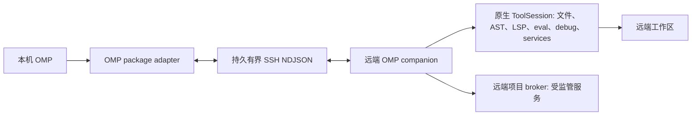

# OMP SSH Remote

简体中文 | [English](README.md)

OMP SSH Remote 将 Oh My Pi 控制面保留在本机，同时通过 SSH 在远端 Linux 主机的持久 companion 中执行有状态的 OMP 原生工作区工具。本 package 只适配 OMP。

## Runtime 边界

本机 OMP 继续负责 TUI、对话、模型凭据、session、Magic Context、`task`、`todo`、browser/computer、peer 消息以及后台任务簿记。每个 OMP session 使用一个独立远端 companion，持有远端文件系统、前台进程、hashline snapshot、AST proposal、LSP client、eval kernel、debugger session，以及该项目的受监管进程 broker。

远端原生工具：

`read`、`write`、`edit`、`bash`、`grep`、`glob`、`lsp`、`ast_grep`、`ast_edit`、受限 `eval` 和 `debug`。

后台执行按归属划分，而不是按工具名划分：

- `bash async:true` 在本机当前 session 的 OMP job manager 中创建 job；原生 `wait` 和 job 的 `proc://` 查询、取消留在本机，命令在远端执行。独立根 session 不共用 manager；子代理使用各自 session family 的 manager。
- 带 `name` 的 `bash` 启动远端服务。服务 `proc://<name>` 的读写（包括 `/kill`、`/mode`）路由远端；裸 `read proc://` 合并两端列表。本机 job/agent 名称优先，启动时拒绝冲突名称。远端服务通过本机协调 job 接入原生 `wait`；断连令 job 失败，不回落到本机执行。
- `/remote-exit`、session 关闭或传输丢失时，companion 会停止本 session 启动的受监管进程；以 `persist` 或 `detached` 启动的进程按显式要求存活，与原生 OMP 一致。

普通非隔离子代理继承连接配置，但各自使用独立 companion。准入比较远端执行契约和原生工具 schema。`task isolated:true` 继续明确拒绝。保留宿主原生审批规则；wrapper 在 session 初始化、首个模型请求前安装，不在连接时临时注册。

服务在远端启动前先预留本机 job；本机容量满时不会先启动一个无人追踪的服务。启动期间的提前完成通知会保留，成功启动后取消会停止远端服务。

OMP 18.11 兼容：远端异步 Bash 转发实时和终态卡片更新，日志及 `wait` 仍由本机 job manager 管理。服务等待就绪期间观察所属 session 的 steering／peer 消息队列；插话只结束就绪等待，不停止服务。follow-up 和 `interruptMode: wait` 不触发提前返回。这里使用公开 session 事件，而非原生工具的私有 steering signal；没有 session 队列事件的隐藏内部 steering 不在桥接范围内。远端 `read`／`grep` 与 hashline `edit` 共享原生截断行保护：先用 `:raw` 读完整行再编辑。

显式停止服务成功后，根据原生 stop 回执结束本机协调任务。不会把主动停止当成自然退出：broker 对显式 stop 不发送 `daemon-completed`。停止失败时继续保留追踪。

连接期间明确拒绝用户直接 shell（`!`/`!!`）和 Python 快捷入口，避免静默执行本机命令；请使用远端 `bash`/`eval`，或退出连接后使用本机快捷入口。未适配的 `find`、`security_scan`、`checkpoint`、`rewind`、`ida`（包括 xdev 入口）明确拒绝。远端 eval 只支持计算和远端工作区工具回调，不桥接本机 agent/workpool、judge/completion、archive、browser、todo；固定的工作区说明解释此边界，本机编排请用顶层工具。

截断输出保存在远端 `~/.cache/omp-ssh-remote/artifacts/<namespace>`。连接到同一主机后，可用 `read` selector 或 `grep` 读取返回的 `remote-artifact://<namespace>/<id>`。companion 正常退出时删除自己的 namespace，启动时清扫超过一小时且所属 worker 已不存在的 namespace；因此 transport 丢失遗留的 artifact 会过期，但永远不会复制到本机。本机 `artifact://` 仍保持本机语义。`xd://debug` 与直接 debug 一样在远端执行。

连接时会把固定白名单的执行域 settings 转发给 companion：`tools.maxTimeout/artifactMaxBytes`、`bash.gitGuard/direnv/direnvLoadTimeoutMs`、`bashInterceptor.enabled/patterns`、`grep.context*`、`read.defaultLimit/renderMarkdown/summarize.*`、`images.autoResize`、`edit.fuzzyMatch/fuzzyThreshold/enforceSeenLines/blockAutoGenerated`、`lsp.formatOnWrite/diagnostics*`。取值来自宿主对本机项目的有效 settings。`tools.artifactMaxBytes` 单位为 MiB，`0` 表示不限；配置上限时 artifact 保留首尾，而非保存全部输出字节。`bash.gitGuard` 在远端执行原生破坏性 Git 操作保护。companion 在内存中同时初始化工具和 shell settings，不加载远端项目配置，也不复制本机凭据。影响工具 schema 的 key（`async.enabled`、`edit.mode`、`eval.*`、`memory.backend`、`skillful`）和审批规则（`bash.patterns`、`bash.allowCompoundCommands`）永远不转发：schema 由编译后的 companion 固定，审批在本机评估。`worktree.clone` 在远端固定关闭，保证 `git worktree add` 作为普通 git 执行，而不是被改写成 companion 自调用。每次调用都会带上本机当前激活的工具集，使 bash interceptor 只重定向到模型实际拥有的工具。



## 环境要求

- 本机 Linux 或 WSL，OMP `>=18.11.0`，并安装 Bun `1.3.14+`、npm、tar、OpenSSH 和 SCP；
- 远端为 glibc Linux `x86_64` 或 `aarch64`；
- 公钥 SSH 可在 batch mode 下登录；
- 远端项目目录已存在；
- 远端需要安装项目所需的 language server 和 debug adapter，但不需要安装 Bun 或 OMP。

主机密钥使用严格校验。请通过正常的 OpenSSH `known_hosts` 信任主机，不要关闭 host checking。插件同时禁用 agent forwarding 和 SSH forwarding。

## 构建与安装

在仓库根目录执行：

```bash
bun install --frozen-lockfile
bun run build:omp
bun run build:worker:all
omp plugin link "$PWD/packages/omp"
```

package 必须包含：

```text
packages/omp/dist/extension.js
packages/omp/dist/worker-linux-x64
packages/omp/dist/worker-linux-x64.sha256
packages/omp/dist/worker-linux-arm64
packages/omp/dist/worker-linux-arm64.sha256
```

链接后重启 OMP。更新时执行 `git pull`，重新构建 extension 和 workers，再重启或 reload plugin。连接状态下 reload 会关闭该 session 的 companion，之后需要重新连接。

当前 companion 基于 OMP 18.11.0 构建，runtime contract 为 0.9.0，包含原生 broker IPC 迁移。更新 runtime 依赖时即使 wire schema 不变，也需要重建双架构 worker。原生 addon 以逐文件 zstd 形式嵌入，首次使用时解包；构建缓存按架构、版本隔离。握手失败报告具体版本和 schema 差异。

## 连接与操作

可以使用标准 `~/.ssh/config` alias 或 OMP `/ssh add` 记录：

```text
/remote-connect gpu-box /srv/project
/remote-status
/remote-reconnect [--force]
/remote-exit
```

显式形式：

```text
/remote-connect user@example.com /srv/project --port 22 --identity ~/.ssh/id_ed25519
```

模型也可以通过 `remote_connect`、`remote_workspace_status`、`remote_reconnect` 和 `remote_exit` 执行相同生命周期。状态工具按需调用，报告进程内已知状态；它不会向每一轮注入 prompt，也不会主动 ping SSH。

连接时普通文件路径远端执行，内部 URI resource 留在本机。混合本机 URI 和远端路径的操作会被拒绝。已选择的连接失效后继续 fail-closed，直到 `/remote-reconnect` 重新建立 transport，或显式 `/remote-exit` 恢复本机执行。reconnect 复用已保存的连接参数和远端目录，保留已注册的 wrapper，丢弃死亡 companion 内的 AST proposal，且仅 owner 可执行；`--force` 会替换仍显示为已连接的 transport。断连时被停止的非持久服务不会自动重启。

## 部署与安全

adapter 探测远端平台和 home，选择 package 自带的对应 worker，校验本机 SHA-256 sidecar，用 `scp -C` 压缩上传到 UUID 临时路径，在远端复核 SHA-256 后原子启用到：

```text
~/.cache/omp-ssh-remote/omp-1/<sha256>/worker-linux-<arch>
```

启用时清理更旧的 worker，保留当前版本、最近一个旧版本及仍在使用的版本。worker 持有版本目录的共享 `flock` 租约；清理须取得独占租约，并通过 `/proc` 检查未使用租约的旧 worker。不能删除活跃可执行文件，否则后续 JS 内核和 broker 自调用会失败。协议 frame 上限为 16 MiB，部署 stdout/stderr 上限为 1 MiB。SSH 使用 batch mode、严格 host checking、`ForwardAgent=no` 和 `ClearAllForwardings=yes`。断连时 pending call 报错，不在本机重试；主动通过 `nohup` 或 `setsid` 脱离监管的进程可能继续存活。

连接界面显示探测、缓存检查、上传、激活阶段。`remote_connect` 工具响应取消，`/remote-exit` 可取消进行中的命令部署。同一扩展实例内的同主机部署串行执行并重新检查缓存，避免重复上传；上传失败后在 SSH 可达时尽力清理临时文件。宿主 schema 在每个已加载扩展实例内缓存，供重连和子会话复用。

## 已验证性能

2026 年 10 月，OMP 18.9.1、trialsfinder Linux x86_64、缓存 worker 与持久 SSH ControlMaster；交错测量 10 次 echo/read/bash，包含首调用：

| 操作 | 中位数 |
| --- | --- |
| 持久 SSH echo 往返 | `8.02 ms` |
| 远端 read | `24.63 ms` |
| 前台 Bash | `17.01 ms` |

worker 初始化 `2439 ms`。另一次首次上传／部署耗时 `88.36 s`，该轮 read/bash 中位数约 `0.8 s`，后续交错对照测量恢复到上表水平。这不是受控的前后加速对比。宿主 schema 缓存减少重复构造元数据 runtime，但不减少每个 worker 的基础内存，本次不宣称内存降低。ARM64 仅完成构建验证，未进行实机性能验收。

## 提示缓存稳定性

连接、断开、重连只切换执行绑定，不改变工具列表或描述。`remote_workspace_status` 的固定说明讲清路由规则、远端限制和何时查状态。保留原生审批和渲染，不替换其他插件拥有的工具。启动时没有绑定的工具在远端明确拒绝，不通过重连临时注册。

绑定变化后，在下一次模型请求的上下文末尾追加简短通知，不额外启动模型回合。状态不变不重复提醒。通知及其消息锚点作为扩展数据保存，不改写原始 transcript；后续请求在原位置重放通知。压缩移除锚点时重新追加当前状态。恢复历史不会因为旧通知写着远端就恢复 SSH 连接。切换期间的调用不会在新环境重试，过期结果和更新会被拒绝或抑制。

`scripts/smoke-cache.ts` 在真实 OMP 中使用本地 HTTP 接收端和合成回复，对比本机、连接、重连、断开前后的实际序列化工具、系统消息和完整历史前缀，同时通过 SSH 执行真实工作区命令。它验证前缀相等，**不伪造供应商 cached tokens 或费用节省数字**。可复现命令见 [English README](README.md#prompt-cache-stability)。

`scripts/smoke-lifecycle.ts` 另行验证真实文件／编辑／计算／artifact、异步输出卡片与原生 `wait`、服务插话、主动停止追踪、自然退出状态和本机恢复。验收期间延后由 agent 发起的模型回合，避免测试触发模型请求。按上述英文说明用相同参数把脚本打包到 worker 旁，执行命令改为 `/remote-lifecycle-smoke`，结束后删除生成的 bundle。

升级或 reload 插件本身可能引起一次初始前缀变化。模型／配置切换、其他插件、上下文压缩以及供应商缓存过期不属于连接切换保证。缓存前缀稳定机制本身只需构建本机扩展；更新 runtime 依赖或协议时仍须重新构建并部署 companion 二进制。

## 限制

- 仅支持 Linux glibc x86_64 和 ARM64；
- OMP `>=18.11.0`，且 companion schema 匹配；
- 远端须有 util-linux 的 `flock`，用于保护活跃 worker 可执行文件；
- 支持显式 async Bash；不桥接自动后台化和交互 Bash PTY；
- 不支持 `task isolated:true` 远端 worktree；
- 不支持远端到本机 artifact bridge；
- 白名单之外的 settings 在 companion 中保持编译默认值，不提供任意 settings 透传；
- 每个 session 或子代理各占一个 companion 进程；并发子代理各消耗一条 SSH 通道和一个 worker 进程；
- 单个输出 frame 不能超过 16 MiB；
- browser、desktop、模型凭据、memory 和本机 session 控制面不进入远端。
